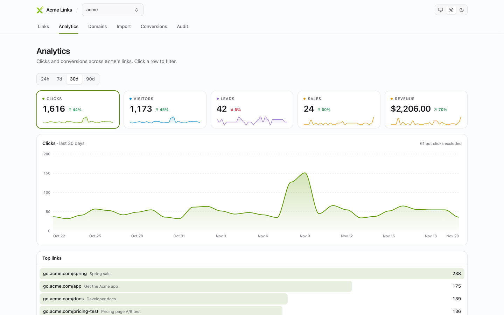
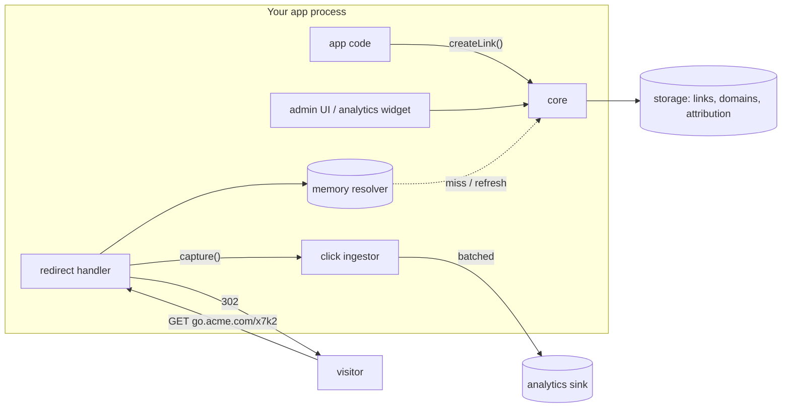
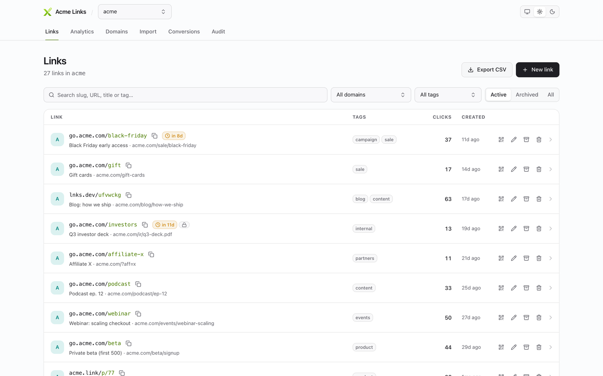
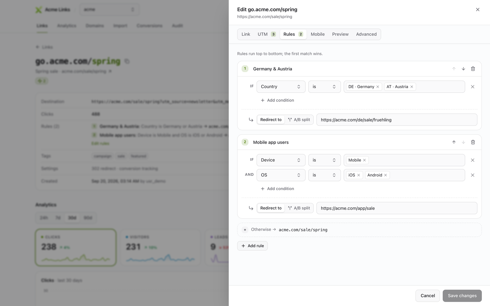
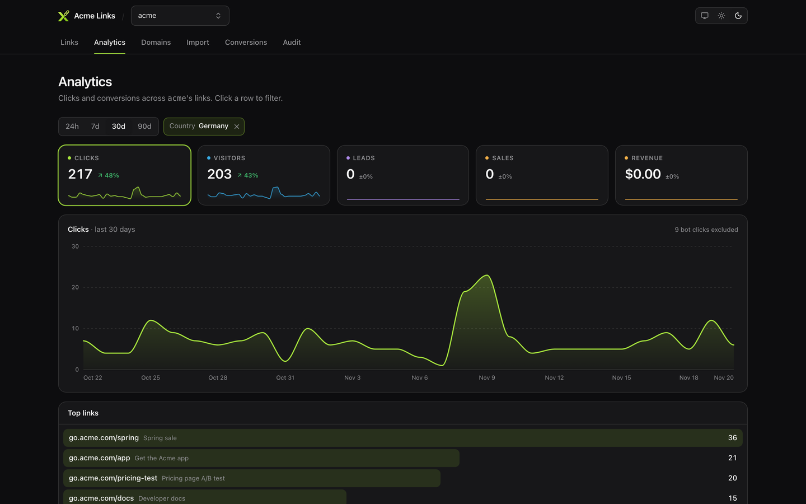
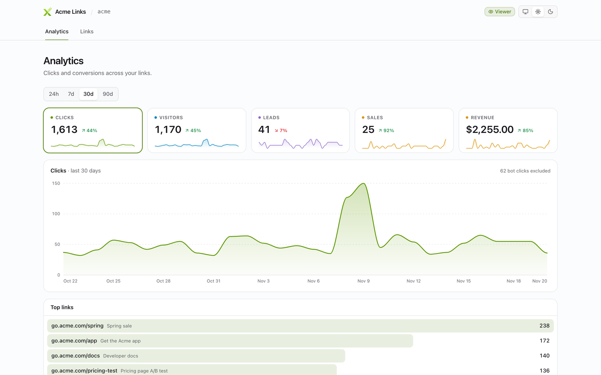

<div align="center">

<picture>
  <source media="(prefers-color-scheme: dark)" srcset="https://raw.githubusercontent.com/xantiagoma/xtandard-links/main/docs/assets/lockup-horizontal-dark.svg" />
  
</picture>

# @xtandard/links

**Self-hosted, embeddable branded short links: memory-first redirects, click analytics, conversion attribution and deep links — as a library.**

Mount it inside your existing app, point it at the database you already run, and give your product (and your customers) branded short links with targeting rules, QR codes, analytics and an embeddable dashboard — no per-click SaaS pricing, no separate service to operate.

[](https://github.com/xantiagoma/xtandard-links/actions/workflows/ci.yml)
[](https://www.npmjs.com/package/@xtandard/links)
[](./LICENSE)
[](https://me.xantiagoma.com/xtandard-links/)

**Documentation: [me.xantiagoma.com/xtandard-links](https://me.xantiagoma.com/xtandard-links/)** — guides and the full API reference.



</div>

> A redirect never waits on your database or your analytics. Links resolve from memory, clicks are
> captured in the background, and your customers see their own numbers through an embeddable
> widget.

## Contents

- [Why another link shortener?](#why-another-link-shortener)
- [How it works — two planes](#how-it-works--two-planes)
- [Quickstart](#quickstart)
- [Create your first link](#create-your-first-link)
- [Targeting rules and A/B tests](#targeting-rules-and-ab-tests)
- [Click analytics](#click-analytics)
- [Conversion attribution](#conversion-attribution)
- [Deep links](#deep-links)
- [The analytics widget](#the-analytics-widget)
- [Storage backends](#storage-backends)
- [Subpath exports](#subpath-exports)
- [Examples](#examples)
- [Screenshots](#screenshots)
- [CLI](#cli)
- [Testing](#testing)
- [Documentation](#documentation)
- [Project status](#project-status)
- [The xtandard ecosystem](#the-xtandard-ecosystem)
- [License](#license)

## Why another link shortener?

Every permissive, maintained shortener is a **standalone app** — Shlink (PHP), Kutt (Express),
YOURLS (PHP), chhoto-url (Rust). The TypeScript ones with real analytics (Dub, Sink) are **AGPL**,
and Dub's open core depends on hosted Tinybird, Upstash and PlanetScale. Nothing lets a TypeScript
SaaS add branded short links and click analytics _inside its own app and database_ — the email tool
that tracks links in newsletters, the CRM that shortens links per contact, the social scheduler that
needs QR codes and per-customer analytics.

`@xtandard/links` is that library:

- **Embeddable**: `createLinksCore({ storage })` + one mount line per framework (Elysia, Hono,
  Express, Bun, Next.js). Your process, your database.
- **Fast and resilient redirects**: a memory-first resolver (LRU + TTL + stale-while-revalidate +
  negative cache + last-known-good); the redirect handler never throws into your app and never waits
  on analytics.
- **Real analytics**: async batched click capture with bot and link-preview filtering, user-agent
  parsing, geo from edge headers, privacy modes (IPs dropped by default). Rollups in the same
  database on day one; ClickHouse, Tinybird or Workers Analytics Engine when you outgrow it.
- **Beyond redirects**: targeting rules and A/B splits, expiry and click budgets, passwords, link
  previews (Open Graph), UTM templates, QR codes, bulk CSV import from Bitly/Dub/Shlink/Kutt,
  conversion attribution (`trackLead` / `trackSale`), and deep links with `apple-app-site-association`
  / `assetlinks.json`, store fallback and deferred deep linking — the Firebase Dynamic Links gap.
- **Multi-tenant by design**: every link belongs to a tenant; tenants can own branded domains; a
  per-tenant **analytics widget** with scoped, stateless viewer tokens embeds in your product.
- **Same shape as its siblings** [`@xtandard/flags`](https://github.com/xantiagoma/xtandard-flags)
  and [`@xtandard/webhooks`](https://github.com/xantiagoma/xtandard-webhooks): ten storage drivers,
  auth/authorization providers, hooks, a bundled admin UI, React embeds, CLI and Docker image.

If you only need a shortener for yourself and are happy running a separate service, use
[Shlink](https://shlink.io) — it is excellent. See [the landscape](docs/research/landscape.md).

## How it works — two planes



|                | Control plane                                  | Redirect plane                                     |
| -------------- | ---------------------------------------------- | -------------------------------------------------- |
| Surface        | `createLinksCore` + admin API + UI + widget    | `createRedirectHandler` on your short domain       |
| Traffic        | rare, human-driven                             | hot, anonymous, bursty, full of bots               |
| Guards         | auth, authorization, `before` hooks, audit log | rules, expiry, password; never 500s                |
| Failure stance | fail loudly to the operator                    | always answer: redirect, 404 page, or fall through |

See [Architecture](docs/ARCHITECTURE.md) and ADRs [0002](docs/ADR/0002-redirect-plane-independence.md)
and [0004](docs/ADR/0004-panel-and-redirect-handlers.md).

## Quickstart

```sh
bun add @xtandard/links    # or npm i / pnpm add / yarn add
```

Mount the admin panel and the redirect handler in a Hono app (Elysia, Express, Bun and Next.js are
the same two lines — see [Adapters](docs/ADAPTERS.md)):

```ts
import { Hono } from "hono";
import { createLinksCore } from "@xtandard/links";
import { linksPanel, linksRedirect } from "@xtandard/links/hono";
import { createSqliteStorage } from "@xtandard/links/storage/sqlite";

const core = createLinksCore({
  storage: createSqliteStorage({ path: "links.db" }),
  defaultDomain: "localhost",
});

const app = new Hono();
app.route("/links", linksPanel({ core, basePath: "/links" })); // admin UI + API
app.use("*", linksRedirect({ core })); // GET /{slug} → redirect; everything else falls through
export default app;
```

Open `http://localhost:3000/links` for the dashboard. With no `auth` the panel is open — fine on
localhost, not in production: see [Auth](docs/AUTH.md) and [Authorization](docs/AUTHORIZATION.md).

Prefer no code? `STORAGE_DRIVER=sqlite bunx @xtandard/links serve` runs the same panel and
redirects, or use the Docker image (see [Deployment](docs/DEPLOYMENT.md)).

## Create your first link

```ts
const link = await core.createLink({
  url: "https://acme.com/pricing",
  slug: "pricing", // omit for a generated 7-character slug
  tags: ["launch"],
  utm: { source: "newsletter", campaign: "spring" },
});
// → https://localhost/pricing redirects to https://acme.com/pricing?utm_source=newsletter&utm_campaign=spring
```

Links belong to a **tenant** (default `"default"`) and live on a **domain**. Register your branded
domains once (DNS and TLS are your edge's job) and give tenants their own:

```ts
await core.createDomain({
  hostname: "go.acme.com",
  isDefault: true,
  notFoundUrl: "https://acme.com",
});
await core.createDomain({ hostname: "links.customer.com", tenant: "customer-42" });

await core.createLink({ tenant: "customer-42", url: "https://customer.com/sale", slug: "sale" });
// → https://links.customer.com/sale
```

Everything else a link can do — expiry (`expiresAt`, `expiredUrl`, `maxClicks`), `password`, link
previews (`preview: { title, description, image }` served to Slack, X, iMessage…), `redirectStatus`,
query pass-through, `externalId` for idempotent upserts, QR codes, bulk CSV import — is in
[Links](docs/LINKS.md).

## Targeting rules and A/B tests

Rules are evaluated in order; the first rule whose conditions all match wins. A rule sends visitors
to one URL or splits them across weighted variants — deterministically, so a visitor keeps seeing the
same variant.

```ts
await core.createLink({
  slug: "app",
  url: "https://acme.com/download",
  ios: "https://apps.apple.com/app/id123456789",
  android: "https://play.google.com/store/apps/details?id=com.acme",
  rules: [
    {
      when: [{ field: "country", op: "in", values: ["DE", "AT", "CH"] }],
      url: "https://acme.de/download",
    },
    {
      name: "Landing page test",
      when: [{ field: "device", op: "in", values: ["desktop"] }],
      variants: [
        { id: "a", url: "https://acme.com/download?v=a", weight: 50 },
        { id: "b", url: "https://acme.com/download?v=b", weight: 50 },
      ],
    },
  ],
});
```

Conditions: `device`, `os`, `browser`, `country`, `continent`, `language`, `referrer`, `qr`, `query`
parameters and `time` windows. See [Rules](docs/RULES.md) and
[ADR 0011](docs/ADR/0011-rules-engine.md).

## Click analytics

Every redirect becomes a click event — captured after the response, batched, and written to an
**analytics sink**:

- **Bots and link previews** are detected (`isBot`, `isPreviewBot`) and flagged, never counted as
  clicks (or dropped with `bots: "drop"`).
- **Device, OS and browser** come from a built-in user-agent parser; **country, region, city** from
  edge headers (Cloudflare, Vercel, CloudFront, Fastly) or your own `GeoResolver` (e.g. MaxMind).
- **Privacy first**: IPs are dropped by default (`privacy.ip: "truncate" | "hash" | "full"` to opt
  in); unique visitors are a daily-salted hash; `respectDoNotTrack` honours DNT / GPC.

```ts
const stats = await core.queryAnalytics({
  tenant: "default",
  from: "2026-11-01T00:00:00Z",
  to: "2026-12-01T00:00:00Z",
  interval: "day",
  groupBy: "country",
});
// → { totals: { clicks, botClicks, leads, sales, saleAmount }, timeseries: [...], breakdown: [...] }
```

The default sink stores hourly and daily **rollups in the same storage** as your links. When you
outgrow it, swap the sink and keep everything else:

```ts
import { createClickHouseAnalytics } from "@xtandard/links/analytics/clickhouse";

const core = createLinksCore({
  storage,
  analytics: createClickHouseAnalytics({ url: process.env.CLICKHOUSE_URL!, createTable: true }),
});
```

Tinybird (`analytics/tinybird`) and Cloudflare Workers Analytics Engine
(`analytics/analytics-engine`) work the same way; all sinks pass one conformance suite. See
[Analytics](docs/ANALYTICS.md) and [ADR 0006](docs/ADR/0006-analytics-sink-port.md).

## Conversion attribution

"Which link brought this signup?" Turn on `trackConversions` and the redirect appends a click id
(`?xl_id=clk_…`) to the destination. Capture it on your site and report conversions server-side:

```ts
// In the browser, on your landing pages:
import { captureClickId, getClickId } from "@xtandard/links/client";
captureClickId(); // stores xl_id in a first-party cookie, cleans the URL

// On your server, when the visitor signs up / pays:
await core.trackLead({ clickId, customerId: user.id, name: "Sign up" });
await core.trackSale({ customerId: user.id, amount: 4900, currency: "USD", invoiceId: "inv_123" });
```

Leads and sales show up next to clicks in every analytics query. See
[Conversions](docs/CONVERSIONS.md).

## Deep links

Register your apps on a domain and the redirect handler serves the association files the OS needs
for universal links / app links:

```ts
await core.createDomain({
  hostname: "go.acme.com",
  apps: {
    ios: { appIds: ["ABCDE12345.com.acme.app"] },
    android: [{ packageName: "com.acme.app", sha256CertFingerprints: ["AB:CD:…"] }],
  },
});
// GET https://go.acme.com/.well-known/apple-app-site-association
// GET https://go.acme.com/.well-known/assetlinks.json
```

Visitors without the app are routed to `link.ios` / `link.android` (the store listing, with the
Play install referrer carrying the click id). With `deepLink: { path: "/product/42", deferred: true }`
the app can claim the original destination on first open — `POST /_links/deferred/claim` — exact by
click id or by a privacy-preserving fingerprint. See [Deep links](docs/DEEP_LINKS.md).

## The analytics widget

Show each of your customers the clicks on _their_ links, inside your product. Mint a short-lived,
tenant-scoped viewer token server-side and render the widget:

```ts
import { createViewerToken } from "@xtandard/links";
const token = await createViewerToken(process.env.LINKS_VIEWER_SECRET!, { tenant: org.id });
```

```tsx
import { LinkAnalytics } from "@xtandard/links/react";
import "@xtandard/links/react/styles.css";

<LinkAnalytics apiBaseUrl="/links" token={token} />;
```

Tokens are stateless HMAC grants, force-scoped to one tenant (optionally to specific links) and to
the actions you allow. See [Analytics widget](docs/WIDGET.md) and
[ADR 0009](docs/ADR/0009-analytics-viewer-tokens.md).

## Storage backends

Links, domains and attribution data live behind a four-method KV contract. Every driver passes the
same conformance suite; the redirect plane caches on top of whichever you pick.

| Driver        | Import                                  | Watch (instant cache eviction)     | Compare-and-swap |
| ------------- | --------------------------------------- | ---------------------------------- | ---------------- |
| Memory        | `@xtandard/links/storage/memory`        | ✓                                  | ✓                |
| File (JSON)   | `@xtandard/links/storage/file`          | ✓                                  | —                |
| Redis         | `@xtandard/links/storage/redis`         | ✓ (keyspace events)                | ✓                |
| Postgres      | `@xtandard/links/storage/postgres`      | via `withWatch` + `pgListenNotify` | ✓                |
| Drizzle       | `@xtandard/links/storage/drizzle`       | via `withWatch`                    | ✓ (pg, sqlite)   |
| MongoDB       | `@xtandard/links/storage/mongodb`       | via `withWatch`                    | ✓                |
| SQLite        | `@xtandard/links/storage/sqlite`        | —                                  | ✓                |
| libSQL/Turso  | `@xtandard/links/storage/libsql`        | —                                  | ✓                |
| unstorage     | `@xtandard/links/storage/unstorage`     | via `withWatch`                    | —                |
| Cloudflare KV | `@xtandard/links/storage/cloudflare-kv` | —                                  | —                |

See [Storage](docs/STORAGE.md) and [ADR 0005](docs/ADR/0005-storage-kv-contract.md).

## Subpath exports

| Import                                                   | What                                                                                             |
| -------------------------------------------------------- | ------------------------------------------------------------------------------------------------ |
| `@xtandard/links`                                        | core, redirect handler, resolver, rules, enrichment, sink contract, hooks, tokens, panel handler |
| `@xtandard/links/core` · `/schema`                       | the control plane · the types                                                                    |
| `@xtandard/links/redirect`                               | the redirect plane alone (edge-friendly)                                                         |
| `@xtandard/links/client`                                 | browser click-id capture for conversions                                                         |
| `@xtandard/links/deeplinks` · `/qr` · `/import`          | association files · QR codes (SVG) · CSV import/export                                           |
| `@xtandard/links/storage/*` · `/drizzle/*`               | storage drivers · Drizzle table helpers                                                          |
| `@xtandard/links/analytics/*`                            | `kv` (default), `memory`, `clickhouse`, `tinybird`, `analytics-engine`                           |
| `@xtandard/links/auth/*` · `/authorization/*`            | `none`, `basic`, `delegated` · `none`, `roles`, `delegated`                                      |
| `@xtandard/links/{elysia,elysia2,hono,express,bun,next}` | framework adapters: `linksPanel` + `linksRedirect`                                               |
| `@xtandard/links/react` (+ `/react/styles.css`)          | `<LinksDashboard>`, `<LinkAnalytics>`                                                            |
| `@xtandard/links/bridges/{webhooks,audit}`               | publish events to `@xtandard/webhooks`, record changes in `@xtandard/audit`                      |
| `@xtandard/links/hooks/log` · `/testing`                 | a logging hook · test helpers                                                                    |

## Examples

Runnable examples live in [`examples/`](examples/) — each is a few lines on top of the library:

```sh
bun run examples:hono         # panel + redirects in Hono, SQLite storage
bun run examples:elysia       # Elysia plugin with Eden-typed admin API
bun run examples:express      # Express middleware
bun run examples:bun          # Bun.serve, no framework
bun run examples:conversions  # click → lead → sale attribution end to end
bun run examples:deep-links   # AASA / assetlinks, store fallback, deferred claim
bun run examples:react-embed  # <LinksDashboard> and <LinkAnalytics> in a React host
bun run demo                  # the full demo with realistic seed data
```

There is also a Next.js app-router example and a Cloudflare Workers example (Workers KV + Analytics
Engine) — see [`examples/README.md`](examples/README.md).

## Screenshots

| Links                                                       | Link editor (rules)                                       |
| ----------------------------------------------------------- | --------------------------------------------------------- |
|                           |             |
| **Analytics (dark)**                                        | **Analytics widget**                                      |
|  |  |

More in [UI](docs/UI.md).

## CLI

```sh
STORAGE_DRIVER=sqlite bunx @xtandard/links serve --domain go.acme.com
bunx @xtandard/links links create https://acme.com/pricing --slug pricing --tag launch
bunx @xtandard/links import bitly-export.csv --format bitly
bunx @xtandard/links stats default --days 30
bunx @xtandard/links qr https://go.acme.com/pricing -o pricing.svg
```

Every command reads its storage from the same environment variables (`STORAGE_DRIVER`,
`STORAGE_SQLITE_PATH`, `REDIS_URL`, …). See [CLI](docs/CLI.md).

## Testing

`@xtandard/links/testing` gives you an in-memory core, a redirect handler whose clicks you can flush
and inspect, and realistic request builders:

```ts
import { clickRequest, createTestLinks, USER_AGENTS } from "@xtandard/links/testing";

const { core, redirects, flush, events } = createTestLinks();
await core.createLink({ url: "https://example.com", slug: "hi" });
const res = await redirects.fetch(
  clickRequest("https://sho.rt/hi", { userAgent: USER_AGENTS.iphone, country: "DE" }),
);
await flush();
// res.status === 302; events[0] is the enriched click
```

See [Testing](docs/TESTING.md) for how this repository is tested (storage and sink conformance
suites, adapters, browser e2e).

## Documentation

- [Getting started](docs/GETTING_STARTED.md) · [Architecture](docs/ARCHITECTURE.md) ·
  [Links](docs/LINKS.md) · [Rules](docs/RULES.md) · [Analytics](docs/ANALYTICS.md) ·
  [Conversions](docs/CONVERSIONS.md) · [Deep links](docs/DEEP_LINKS.md) · [Widget](docs/WIDGET.md)
- [Storage](docs/STORAGE.md) · [Adapters](docs/ADAPTERS.md) · [HTTP API](docs/HTTP_API.md) ·
  [Auth](docs/AUTH.md) · [Authorization](docs/AUTHORIZATION.md) · [Hooks](docs/HOOKS.md) ·
  [UI](docs/UI.md) · [CLI](docs/CLI.md) · [Deployment](docs/DEPLOYMENT.md) ·
  [Testing](docs/TESTING.md) · [Releases](docs/RELEASES.md) · [Brand](docs/BRAND.md)
- Decisions: [ADRs](docs/ADR/) · Research: [landscape](docs/research/landscape.md)

## Project status

`0.x` (ZeroVer, like its siblings): the API is usable and tested, and may still change between minor
versions. See the [CHANGELOG](CHANGELOG.md).

## The xtandard ecosystem

`@xtandard/links` is one of a family of open-source, MIT-licensed projects that share the xtandard name. They are independent of each other: use any of them on its own. The products share their building blocks through `@xtandard/kit`, a regular dependency you never install or configure yourself.

| Project                              | What it is                                                                                                                                                                                                      | Links                                                                                                                                                                                  |
| ------------------------------------ | --------------------------------------------------------------------------------------------------------------------------------------------------------------------------------------------------------------- | -------------------------------------------------------------------------------------------------------------------------------------------------------------------------------------- |
| **`@xtandard/links`** (this package) | Self-hosted, embeddable branded short links with click analytics, conversion attribution and deep links: a Dub / Bitly alternative as a library                                                                 | [Docs](https://me.xantiagoma.com/xtandard-links/) · [GitHub](https://github.com/xantiagoma/xtandard-links) · [npm](https://www.npmjs.com/package/@xtandard/links)                      |
| **`@xtandard/kit`**                  | The shared building blocks of the xtandard products: storage drivers and conformance suite, auth, HTTP plumbing, adapters, admin shell and tooling                                                              | [Docs](https://me.xantiagoma.com/xtandard-kit/) · [GitHub](https://github.com/xantiagoma/xtandard-kit) · [npm](https://www.npmjs.com/package/@xtandard/kit)                            |
| **`@xtandard/lib`**                  | Lightweight, type-safe TypeScript utilities with a zero-dependency core                                                                                                                                         | [Docs](https://me.xantiagoma.com/xtandard/) · [GitHub](https://github.com/xantiagoma/xtandard) · [npm](https://www.npmjs.com/package/@xtandard/lib)                                    |
| **`@xtandard/flags`**                | A self-hosted, embeddable, OpenFeature-compatible feature-flag control plane with pluggable storage                                                                                                             | [Docs](https://me.xantiagoma.com/xtandard-flags/) · [GitHub](https://github.com/xantiagoma/xtandard-flags) · [npm](https://www.npmjs.com/package/@xtandard/flags)                      |
| **`@xtandard/webhooks`**             | A self-hosted, embeddable, Standard Webhooks-compliant outbound-webhooks control plane: a Svix alternative as a library                                                                                         | [Docs](https://me.xantiagoma.com/xtandard-webhooks/) · [GitHub](https://github.com/xantiagoma/xtandard-webhooks) · [npm](https://www.npmjs.com/package/@xtandard/webhooks)             |
| **`@xtandard/audit`**                | A self-hosted, embeddable, tamper-evident audit-log control plane for B2B SaaS: a WorkOS Audit Logs alternative as a library                                                                                    | [Docs](https://me.xantiagoma.com/xtandard-audit/) · [GitHub](https://github.com/xantiagoma/xtandard-audit) · [npm](https://www.npmjs.com/package/@xtandard/audit)                      |
| **`@xtandard/entitlements`**         | An embeddable entitlements, plans and usage-metering engine: typed catalog, atomic metering, any billing provider, admin UI and customer portal                                                                 | [Docs](https://me.xantiagoma.com/xtandard-entitlements/) · [GitHub](https://github.com/xantiagoma/xtandard-entitlements) · [npm](https://www.npmjs.com/package/@xtandard/entitlements) |
| **`@xtandard/xyte`**                 | A Zyte API-compatible `/v1/extract` client and server that runs on any proxy provider, or none                                                                                                                  | [Docs](https://me.xantiagoma.com/xyte/) · [GitHub](https://github.com/xantiagoma/xyte) · [npm](https://www.npmjs.com/package/@xtandard/xyte)                                           |
| **xtandard-image**                   | A self-hosted image and video processing server in Go and libvips: imgproxy-compatible URLs plus the imgix, Cloudinary, ImageKit, Cloudflare and Thumbor dialects, with a TypeScript client (`@xtandard/image`) | [Docs](https://me.xantiagoma.com/xtandard-image/) · [GitHub](https://github.com/xantiagoma/xtandard-image) · [npm](https://www.npmjs.com/package/@xtandard/image)                      |

### Related

- [drizzle-cursor](https://github.com/xantiagoma/drizzle-cursor): cursor-based pagination for Drizzle ORM
- [drizzle-audit](https://github.com/xantiagoma/drizzle-audit): configurable audit logging for Drizzle ORM

## License

[MIT](./LICENSE) © Santiago Montoya. Brand artwork credits in [NOTICE](./NOTICE).
