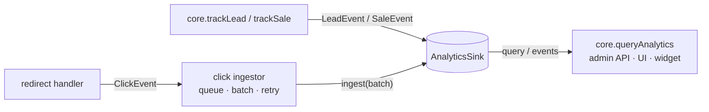

# Click analytics

Every redirect becomes a click event: enriched from the request, captured after the response,
batched, and written to an **analytics sink**. Leads and sales ([Conversions](CONVERSIONS.md)) flow
into the same sink, so one query answers clicks, signups and revenue per link.

## The pipeline



The redirect builds the event synchronously and hands it to the ingestor in a detached promise; the
response never waits on the sink. Batching, retries and drop policy are described in
[Architecture](ARCHITECTURE.md#click-ingestion).

## What a click records

```ts
interface ClickEvent {
  type: "click";
  id: string; // "clk_…", also the attribution click id
  at: string; // ISO-8601
  tenant: string;
  linkId: string;
  domain: string;
  slug: string;
  destination: string; // the final URL the visitor was sent to
  ruleId?: string; // the rule that matched
  variant?: string; // the A/B arm
  country?: string; // ISO alpha-2, uppercase
  continent?: string;
  region?: string;
  city?: string;
  device: DeviceType; // desktop | mobile | tablet | tv | console | bot | unknown
  os: string; // ios | android | windows | macos | linux | …
  browser: string; // chrome | safari | firefox | edge | …
  language?: string; // primary Accept-Language tag
  referrer?: string; // full Referer (or ?ref=)
  referrerHost: string; // hostname or "(direct)"
  ip?: string; // per privacy mode; absent by default
  visitor?: string; // daily-salted visitor hash
  userAgent?: string; // only with privacy.userAgent
  bot: boolean;
  qr: boolean; // the short URL carried ?qr=1
  utm?: Utm; // the short URL's utm_* merged over the link's utm
}
```

Only `GET` requests are recorded (`HEAD` and password-form posts are not), and nothing is recorded
with `ingestor: false` on the redirect handler.

## Enrichment

All enrichment is zero-dependency, runs on edge runtimes, and is replaceable.

### Bots and link previews

`isBot(userAgent)` matches a built-in list in the spirit of `isbot`: search and AI crawlers,
link-preview unfurlers, uptime monitors, headless browsers and automation, HTTP libraries (`curl`,
`python-requests`, `okhttp`, `node-fetch`, …), feed readers and scanners, plus any user agent that
is missing or does not announce `Mozilla/` (or `Opera/`, `Dalvik/`). `isPreviewBot(userAgent)` is
the unfurler subset (Slack, X, Facebook, LinkedIn, WhatsApp, Telegram, Discord, iMessage's
Applebot, …) that gets the [link-preview page](LINKS.md#link-previews).

The redirect handler's `bots` option sets the policy:

- `"flag"` (default): bot clicks are recorded with `bot: true` and `device: "bot"`. They count as
  `botClicks`, never as `clicks`, never toward `maxClicks`, and never create attribution refs or
  deferred handoffs.
- `"drop"`: bot clicks are not recorded at all.

Bots are still redirected either way: a crawler following your link gets where it is going.

### Device, OS and browser

The built-in parser (`parseUserAgent`) returns families, not versions: enough for analytics and
[rules](RULES.md). For finer detail, pass your own parser:

```ts
import { UAParser } from "ua-parser-js";
import { isBot } from "@xtandard/links";

createRedirectHandler({
  core,
  parseUserAgent(ua) {
    const r = UAParser(ua);
    const bot = isBot(ua);
    return {
      bot,
      device: bot ? "bot" : ((r.device.type as "mobile" | "tablet") ?? "desktop"),
      os: (r.os.name ?? "unknown").toLowerCase().replace("mac os", "macos"),
      browser: (r.browser.name ?? "unknown").toLowerCase(),
    };
  },
});
```

### Geo

A `GeoResolver` is `(request, ip) => GeoInfo | Promise<GeoInfo>` (errors are caught). The default,
`edgeHeadersGeo()`, reads the headers edge platforms already attach, first match wins:

| Resolver                    | Reads                                                                                  |
| --------------------------- | -------------------------------------------------------------------------------------- |
| `cloudflareGeo()`           | `request.cf` on Workers; else `CF-IPCountry`, `CF-IPCity`, `CF-IPContinent`, … headers |
| `vercelGeo()`               | `x-vercel-ip-country`, `-country-region`, `-city`, `-latitude`, `-longitude`           |
| CloudFront                  | `cloudfront-viewer-country`, `-city`, `-country-region`                                |
| Fastly                      | `fastly-geo-country`, `fastly-geo-city` (set them in VCL)                              |
| generic                     | `x-country-code`, `x-city`, `x-region`                                                 |
| `headerGeo({ country, … })` | any header names you choose (your own proxy)                                           |

The continent is filled in from the country when the source has none. Self-hosted without an edge,
wrap an IP database lookup:

```ts
import maxmind, { type CityResponse } from "maxmind";

const db = await maxmind.open<CityResponse>("/data/GeoLite2-City.mmdb");

createRedirectHandler({
  core,
  geo: (_request, ip) => {
    const r = ip ? db.get(ip) : null;
    return {
      country: r?.country?.iso_code,
      continent: r?.continent?.code,
      city: r?.city?.names?.en,
      region: r?.subdivisions?.[0]?.names?.en,
    };
  },
});
```

The client IP comes from `CF-Connecting-IP`, `True-Client-IP`, `X-Real-IP`, `Fly-Client-IP`, then
the first `X-Forwarded-For` entry. Those headers are only trustworthy behind a proxy that sets them;
otherwise pass `getIp` (for example from your server's socket address).

### Referrer, language, QR, UTM

- **Referrer**: the `Referer` header, or a `?ref=` parameter on the short URL; `referrerHost` is its
  hostname, `(direct)` when there is none.
- **Language**: the highest-priority primary tag of `Accept-Language`.
- **QR**: `?qr=1` on the short URL marks the click `qr: true` (the [QR helpers](LINKS.md#qr-codes)
  encode it) and is never forwarded to the destination.
- **UTM**: `utm_*` parameters on the short URL, merged over the link's own `utm`.

## Privacy

Defaults are the most private useful setting: no raw IP is ever stored unless you opt in
(ADR [0007](ADR/0007-click-ingestion.md)).

```ts
createRedirectHandler({
  core,
  privacy: {
    ip: "drop", // "drop" (default) | "truncate" | "hash" | "full"
    visitor: "daily-hash", // "daily-hash" (default) | "none"
    userAgent: false, // store the raw user agent on events
    respectDoNotTrack: false, // skip recording for DNT: 1 / Sec-GPC: 1
    salt: process.env.LINKS_VISITOR_SALT, // secret mixed into the daily salt
  },
});
```

| `ip`       | Stored                                                         |
| ---------- | -------------------------------------------------------------- |
| `drop`     | nothing                                                        |
| `truncate` | IPv4 with the last octet zeroed; IPv6 keeps the first 3 groups |
| `hash`     | a daily-salted SHA-256, truncated                              |
| `full`     | the IP as-is (personal data under GDPR: you own that decision) |

**Visitor hash.** `daily-hash` derives `visitor` from `SHA-256(salt + UTC date, tenant, IP, user
agent)`: unique visitors are countable within a day without storing IPs, and the hash cannot be
joined across days or tenants. It also keys [A/B variant](RULES.md#ab-variants) stickiness and the
probabilistic [deferred deep-link](DEEP_LINKS.md) fingerprint.

**Set `salt` in production.** Without it the salt is random per process: hashes differ between
processes and restarts, so uniques over-count, A/B arms are not sticky across instances, and
deferred deep links cannot be matched by a different process than the one that saw the click.

**Do Not Track.** With `respectDoNotTrack`, requests carrying `DNT: 1` or `Sec-GPC: 1` are
redirected normally and not recorded at all.

## The click tap

`onClick(event, link)` on the redirect handler observes every recorded click, fire-and-forget:
errors go to `onError`, and it can never slow or fail a redirect. Use it for live counters, a
webhook per click (`@xtandard/links/bridges/webhooks`, see [Hooks](HOOKS.md)) or a second pipeline.

## Querying

```ts
const result = await core.queryAnalytics({
  tenant: "default", // always exactly one tenant
  from: "2026-11-01T00:00:00Z", // inclusive
  to: "2026-12-01T00:00:00Z", // exclusive
  linkIds: ["lnk_…"], // optional
  filters: { country: ["DE", "AT"] }, // optional: value in list; several dimensions AND
  interval: "day", // "hour" | "day": adds `timeseries`
  groupBy: "referrer", // adds `breakdown`
  limit: 10, // breakdown rows, default 10
});
```

```ts
{
  totals: { clicks, botClicks, leads, sales, saleAmount, uniques? },
  timeseries?: [{ at: "2026-11-01T00:00:00.000Z", clicks, … }], // contiguous, zero-filled, UTC
  breakdown?: [{ key: "news.ycombinator.com", clicks, … }],     // clicks desc, then key
}
```

**Dimensions** (for `groupBy` and `filters`): `link`, `domain`, `country`, `continent`, `city`,
`device`, `os`, `browser`, `referrer` (the host), `utm_source`, `utm_medium`, `utm_campaign`, `qr`
(`"true"` / `"false"`), `variant`. A missing value reads `"(none)"`. Lead and sale events carry the
dimensions of the click they are attributed to (copied from its click ref), so conversions break
down by country, device, referrer, UTM or A/B variant like clicks do.

**Metrics**: `clicks` (non-bot), `botClicks`, `leads`, `sales`, `saleAmount` (minor units, summed as
is across currencies), and `uniques` when the sink can count them.

`sink.events?.({ tenant, linkIds?, types?, before?, limit?, includeBots? })` returns recent raw
events, newest first, for "recent activity" views. The HTTP equivalents are
`GET /api/tenants/:tenant/analytics` and `/events` ([HTTP API](HTTP_API.md)).

## Sinks

| Sink                     | Import                                       | Cross-filter | Uniques | Raw events  | Notes                                            |
| ------------------------ | -------------------------------------------- | ------------ | ------- | ----------- | ------------------------------------------------ |
| KV rollups (default)     | `@xtandard/links/analytics/kv`               | —            | —       | recent 1000 | in your links storage; zero extra infrastructure |
| Memory                   | `@xtandard/links/analytics/memory`           | ✓            | ✓       | ✓           | tests, demos; the reference semantics            |
| ClickHouse               | `@xtandard/links/analytics/clickhouse`       | ✓            | ✓ exact | ✓           | HTTP interface, bound parameters                 |
| Tinybird                 | `@xtandard/links/analytics/tinybird`         | ✓            | ✓ exact | ✓           | Events API + SQL API                             |
| Workers Analytics Engine | `@xtandard/links/analytics/analytics-engine` | ✓            | —       | sampled     | sampled counts; 3-month retention                |

Every sink is `fetch`-based or storage-based, with no peer dependencies, and passes the same
conformance suite (`test/analytics-contract.ts`). A sink declares `capabilities`
(`crossFilter`, `uniques`, `events`, `intervals`); the panel's `/config` reports them and the UI
hides what the sink cannot answer. Pass a sink as `analytics` to `createLinksCore` (or to
`linksPanel` / `createRedirectHandler` when they build the core).

### KV rollups (default)

```ts
import { createKvAnalytics } from "@xtandard/links/analytics/kv";

const analytics = createKvAnalytics({
  storage, // the same LinksStorage as the core
  hourlyRetention: "14d", // default
  dailyRetention: undefined, // default: forever
  recentEvents: 1000, // raw events kept per tenant for events(); 0 disables
});
const core = createLinksCore({ storage, analytics });
```

Each ingested batch is aggregated in memory, then applied with one read-modify-write per touched
bucket (retried with compare-and-swap when the storage supports it). Buckets exist per tenant and
per link, hourly and daily, and carry the metric counters plus per-dimension counters, under
`lnk/rollup/{tenant}/{_|l.{linkId}}/{h|d}/{bucket}`. Queries read daily buckets for whole UTC days
inside the range and hourly buckets at the edges, so results are hour-granular.

What rollups cannot do (the query throws `UnsupportedQueryError`, HTTP `400 UNSUPPORTED_QUERY`):

- **More than one non-link filter dimension**, or a filter on one dimension combined with
  `groupBy` on another (`capabilities.crossFilter: false`). Filtering on `country` and grouping by
  `country` or by `link` (with `linkIds`) works; filtering on `country` and grouping by `device`
  does not.
- **Unique visitors** (`capabilities.uniques: false`).

Bucket retention is not swept automatically: call `analytics.prune()` on a schedule (a cron, a
`setInterval` in a long-lived process) to drop hourly buckets past `hourlyRetention` and daily
buckets past `dailyRetention`. The recent-events log trims itself every 20 batches (and on
`prune()`). Each raw event is also one storage write, so set `recentEvents: 0` on a busy install
that does not need the "recent activity" feed. The rollups write once per touched bucket
per batch, so a busy install on a slow store wants a larger ingestor `batchSize` or an OLAP sink.

### ClickHouse

```ts
import { createClickHouseAnalytics, clickhouseSchema } from "@xtandard/links/analytics/clickhouse";

const analytics = createClickHouseAnalytics({
  url: process.env.CLICKHOUSE_URL!, // http://localhost:8123, https://xyz.clickhouse.cloud:8443
  username: "links", // default "default"
  password: process.env.CLICKHOUSE_PASSWORD,
  database: "default", // default
  table: "links_events", // default
  createTable: true, // CREATE TABLE IF NOT EXISTS before the first request (default false)
  settings: { async_insert: "1", wait_for_async_insert: "0" }, // optional, sent with every request
});
```

One row per event, inserted as `JSONEachRow` (one request per batch); every query value is a
server-side bound parameter, never interpolated. Uniques are exact (`uniqExactIf` over the visitor
hash); `deleteLink` issues a lightweight `DELETE`. To manage the table in your own migrations,
generate the DDL:

```ts
console.log(clickhouseSchema({ database: "analytics", table: "links_events" }));
// engine: "ReplicatedMergeTree" for clusters
```

```sql
CREATE TABLE IF NOT EXISTS `analytics`.`links_events` (
  tenant LowCardinality(String),
  at DateTime64(3, 'UTC'),
  type LowCardinality(String),
  id String,
  link_id String,
  domain LowCardinality(String),
  slug String,
  country LowCardinality(String),
  continent LowCardinality(String),
  city String,
  device LowCardinality(String),
  os LowCardinality(String),
  browser LowCardinality(String),
  referrer String,
  utm_source String,
  utm_medium String,
  utm_campaign String,
  qr LowCardinality(String),
  variant String,
  bot UInt8,
  visitor String,
  amount Int64,
  currency LowCardinality(String),
  data String CODEC(ZSTD(3))
) ENGINE = MergeTree
PARTITION BY toYYYYMM(at)
ORDER BY (tenant, at)
```

Dimension columns hold the value as queries see it (`"(none)"` when absent), and `data` holds the
full event JSON for `events()`. Add a `TTL` clause in your migration if you want retention.

### Tinybird

```ts
import { createTinybirdAnalytics, tinybirdDatasource } from "@xtandard/links/analytics/tinybird";

const analytics = createTinybirdAnalytics({
  token: process.env.TINYBIRD_TOKEN!,
  baseUrl: "https://api.us-east.aws.tinybird.co", // your region; default https://api.tinybird.co
  datasource: "links_events", // default
  wait: false, // true: the Events API acknowledges only committed writes
});
```

Create the data source from the generated `.datasource` file (same columns as the ClickHouse table,
`MergeTree` partitioned by month and sorted by `tenant, at`) and deploy it with your Tinybird
project:

```ts
await Bun.write(
  "datasources/links_events.datasource",
  tinybirdDatasource({ ttl: "toDateTime(at) + INTERVAL 13 MONTH" }), // ttl optional
);
```

Ingestion uses the Events API (NDJSON), queries the SQL API. The SQL API has no bound parameters,
so values are inlined as escaped literals. The token needs `DATASOURCES:APPEND` and
`DATASOURCES:READ` on the data source, plus `DATASOURCES:CREATE` for `deleteLink` (an asynchronous
delete job). Ingestion is eventually consistent unless `wait: true`.

### Workers Analytics Engine

On Cloudflare Workers, write through the dataset binding and read through the SQL API:

```toml
# wrangler.toml
[[analytics_engine_datasets]]
binding = "LINKS_ANALYTICS"
dataset = "links_events"
```

```ts
import { createAnalyticsEngine } from "@xtandard/links/analytics/analytics-engine";

const analytics = createAnalyticsEngine({
  dataset: env.LINKS_ANALYTICS, // the binding: needed to ingest (inside a Worker)
  datasetName: "links_events", // as configured on the binding
  accountId: env.CF_ACCOUNT_ID, // needed to query, from anywhere
  apiToken: env.CF_ANALYTICS_TOKEN, // "Account Analytics: Read"
});
```

Either half is optional: a redirect Worker may only write, and an admin server elsewhere may only
read. Each event is one `writeDataPoint` (tenant as the index, so small tenants are never sampled
away by big ones; dimensions in blobs; time, bot flag and amount in doubles; the full event JSON in
the last blob). Know the platform's trade-offs:

- **Sampling**: at high volume Analytics Engine samples, so counts are
  `SUM(_sample_interval)`, statistically accurate rather than exact; `uniques` are not reported and
  `events()` returns sampled rows.
- **Limits**: 250 data points per Worker invocation, three months of retention, no deletes (no
  `deleteLink`).

### Migrating between sinks

There is no built-in fan-out sink yet. To dual-write during a migration, wrap two sinks yourself:

```ts
import type { AnalyticsSink } from "@xtandard/links";

const both = (primary: AnalyticsSink, secondary: AnalyticsSink): AnalyticsSink => ({
  capabilities: primary.capabilities,
  async ingest(events) {
    await Promise.all([primary.ingest(events), secondary.ingest(events)]);
  },
  query: (q) => primary.query(q),
  ...(primary.events ? { events: (q) => primary.events!(q) } : {}),
});
```

Backfilling history from KV rollups into an OLAP sink is not possible (rollups are aggregates, not
events); switch reads over once the new sink holds enough history.

### Writing a sink

Implement `ingest` and `query` (plus `events` / `deleteLink` / `close` if you can) with the
semantics of `aggregateEvents` in `src/analytics/contract.ts`, the reference implementation, and
run `runAnalyticsContractTests` from `test/analytics-contract.ts` against it
([Testing](TESTING.md)).
