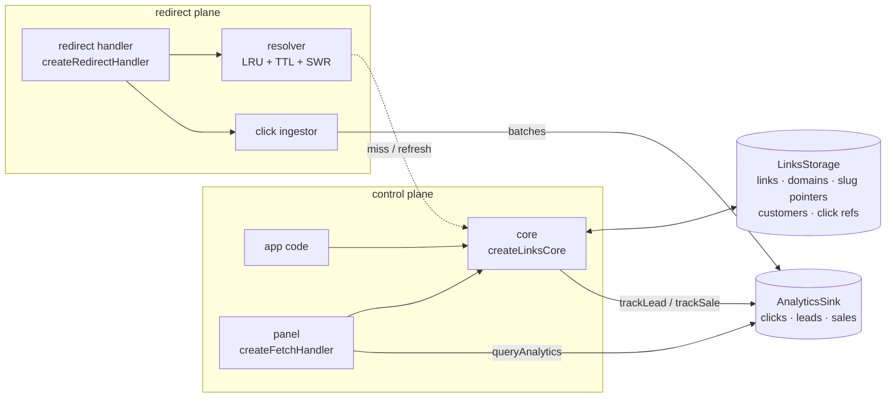

# Architecture

How a click travels from `GET go.acme.com/x7k2` to a redirect and an analytics row, and where each
piece can run.

## Two planes

|                | Control plane                                       | Redirect plane                                           |
| -------------- | --------------------------------------------------- | -------------------------------------------------------- |
| Entry points   | `createLinksCore`, `createFetchHandler` (the panel) | `createRedirectHandler`                                  |
| Traffic        | rare, human-driven                                  | hot, anonymous, bursty, full of bots                     |
| Guards         | auth, authorization, `before` hooks, audit log      | rules, expiry, password                                  |
| Failure stance | throws typed errors (`ValidationError`, `NotFound`) | never throws: redirect, a built-in page, or fall through |
| Dependencies   | `valibot` for validation                            | none beyond Web APIs (edge-safe)                         |

The planes share only the storage and the sink. The redirect handler can run in the same process
as the panel (the common case), or alone on an edge runtime pointing at the same storage and sink
(ADR [0002](ADR/0002-redirect-plane-independence.md), [0004](ADR/0004-panel-and-redirect-handlers.md)).

## The core

`createLinksCore({ storage, analytics?, hooks?, defaultDomain?, … })` owns every write: tenants,
domains, links and their slug pointers, CSV import, conversions (`trackLead` / `trackSale`),
customers, deferred deep-link handoffs and the operator audit log. Mutations validate input, run
`before` hooks (which may veto), write, append an audit entry, notify same-process resolvers
(`onChange`), then run `after` hooks ([Hooks](HOOKS.md)).

Storage is the four-method KV contract (`getItem`, `setItem`, `removeItem`, `getKeys`) with
feature-detected `compareAndSwap` and `watch` ([Storage](STORAGE.md)). The redirect lookup is two
reads: the slug pointer `lnk/s/{hostname}/{slugKey}` → `{ tenant, id }`, then the link record.
Slug uniqueness per domain is a `compareAndSwap({ expected: null })` claim on that pointer when the
driver supports it (ADR [0005](ADR/0005-storage-kv-contract.md)).

The analytics sink defaults to `createKvAnalytics({ storage })`: rollups in the same storage. Pass
`analytics` to use another sink ([Analytics](ANALYTICS.md)).

## The redirect path

What `createRedirectHandler(...).handle(request, ctx?)` does, in order:

1. **Method and path.** Only `GET`, `HEAD` and `POST` (password form, deferred claim) are
   considered. With `basePath` (`/l`), paths outside it return `null`.
2. **Host → domain.** The host (`X-Forwarded-Host`, else the URL host, port stripped) is looked up
   in the resolver's domain cache. `/.well-known/apple-app-site-association` and
   `/.well-known/assetlinks.json` are answered from the domain's `apps` config
   ([Deep links](DEEP_LINKS.md)). An unregistered host returns `null` (not ours) unless `basePath`
   is set, in which case links are looked up on `defaultDomain`.
3. **Special paths.** `POST /_links/deferred/claim` is the app's deferred deep-link claim. The bare
   root `/` redirects to the domain's `rootUrl` or returns `null`. A first path segment in the
   core's `reservedSlugs` (`.well-known`, `api`, `_links`, `favicon.ico`, `robots.txt`) returns
   `null`.
4. **Resolve.** The resolver returns the link for `host/slugKey` from memory, or loads it. Unknown
   or `disabled` links redirect to the domain's `notFoundUrl` when it has one; otherwise `handle`
   returns `null` (and `fetch` renders the 404 page).
5. **Expiry.** `expiresAt` is checked exactly on every request; `maxClicks` against the approximate
   click counter. Expired links go to `expiredUrl`, else a 410 page.
6. **Password.** A password-protected link shows a password form; a correct `POST` sets an
   `HttpOnly` unlock cookie (one hour) and redirects back with `303`.
7. **Visitor context.** User agent → device / OS / browser / bot; geo from edge headers (or your
   `GeoResolver`); `Accept-Language`; referrer host; `?qr=1`; the daily visitor hash.
8. **Destination.** iOS visitors go to `link.ios`, Android visitors to `link.android` (when set);
   otherwise the first matching rule ([Rules](RULES.md)), else `link.url`. Then UTM parameters are
   merged, the short URL's query is forwarded (`passQuery`, default on), the click id is appended
   when conversions are on, and Play Store URLs get the install referrer.
9. **Record, in the background.** The click event is built and handed to the ingestor; the
   non-bot click counter is bumped; with conversions on, a click ref is stored for attribution; on
   a mobile click of a `deepLink.deferred` link, a deferred handoff is stored. All of it runs in a
   detached promise passed to `ctx.waitUntil` when you provide one; the response never waits.
10. **Answer.** Link-preview bots (Slack, X, iMessage, …) get an Open Graph page when the link has
    `preview` set; everyone else gets the redirect (`link.redirectStatus`, default 302) with
    `Cache-Control: private, no-store` and `X-Robots-Tag: noindex` (unless `indexable`).

Any exception after the link was resolved degrades to a 302 to `link.url` (unless the link has a
password) and is reported to `onError`; any earlier exception returns `null`. `handle` never throws.
`fetch` is `handle` that renders the 404 page (through `renderPage`, when set) instead of `null`,
for standalone use.

### What `null` means

`handle` returns `null` for "not a short link": an unregistered host, a reserved first segment, the
root without `rootUrl`, a path outside `basePath`, a method it does not serve, and an **unknown or
disabled slug on a domain without `notFoundUrl`**. Framework adapters turn `null` into the
framework's fall-through (`next()`, the next handler, `undefined` in Next.js middleware), so short
links can sit in front of your own routes on a shared host. On a dedicated short domain, set
`notFoundUrl` (unknown slugs redirect there) or answer with `fetch` (the built-in 404 page).

## The resolver

`createResolver(core, options)` is the memory-first cache in front of storage (ADR
[0002](ADR/0002-redirect-plane-independence.md)):

| Behaviour              | Default                   | Notes                                                                                  |
| ---------------------- | ------------------------- | -------------------------------------------------------------------------------------- |
| LRU                    | `maxEntries: 10_000`      | links, misses and domains share the budget                                             |
| Fresh TTL              | `ttlMs: 60_000`           | `0` disables caching (every request reads storage)                                     |
| Stale-while-revalidate | on                        | an expired entry is served immediately; one background refresh per key                 |
| Negative cache         | `negativeTtlMs: 10_000`   | random-slug scanners and bots do not hammer storage                                    |
| Last known good        | on                        | a storage error serves the cached value (even past TTL) and goes to `onError`          |
| Request coalescing     | on                        | concurrent misses for one key share one load                                           |
| Same-process eviction  | always                    | core mutations evict their keys through `core.onChange`                                |
| Cross-process eviction | `watch: true` when usable | watchable storage (memory, file, Redis, or any driver wrapped with `withWatch`) evicts |
| Preload                | `resolver.preload()`      | warm every link at start; for small installs                                           |

Without watch, an edit made by another process shows up within the TTL. Expiry and `disabled` are
evaluated against the cached record on every request, so a link expiring at noon stops at noon.
Pass resolver options (or a prebuilt resolver) as the redirect handler's `resolver`;
`handler.resolver.stats()` reports hits, misses, stale serves and errors.

## Click ingestion

`createClickIngestor({ sink, batchSize = 100, flushIntervalMs = 1000, maxQueue = 10_000,
retries = 3, retryBaseMs = 200, onError, onDrop })` sits between the redirect and the sink
(ADR [0007](ADR/0007-click-ingestion.md)):

- `capture(event)` enqueues synchronously and never throws.
- Batches flush when `batchSize` events are queued or every `flushIntervalMs` (the timer is
  `unref`'d: it never keeps a process alive), in capture order, with exponential retry. A batch that
  fails `retries` times goes to `onError` and is dropped.
- Past `maxQueue`, the oldest events are dropped and `onDrop` fires. Analytics are best-effort; the
  redirect is not.
- With `capture(event, { waitUntil })` (what the redirect handler does when you pass
  `ctx.waitUntil`), the queue flushes immediately in the background: edge isolates freeze between
  requests, so a timer cannot be trusted there.
- `flush()` / `close()` drain for graceful shutdown. A hard crash loses at most the unflushed
  batch (bounded by `flushIntervalMs`).

Pass ingestor options (or a prebuilt ingestor, or `false` to record nothing) as the redirect
handler's `ingestor`. Enrichment and privacy are described in [Analytics](ANALYTICS.md).

## Sinks

The `AnalyticsSink` port (`ingest`, `query`, optional `events`, `deleteLink`, `close`) receives
clicks from the ingestor and leads and sales from the core, and answers every analytics query.
Each sink declares its `capabilities` (cross-filtering, unique visitors, raw events, intervals);
the API and UI adapt. Built in: `kv` (default, same storage), `memory`, `clickhouse`, `tinybird`,
`analytics-engine`. See [Analytics](ANALYTICS.md) and ADR [0006](ADR/0006-analytics-sink-port.md).

## Deployment shapes

| Shape                      | Control plane                              | Redirect plane                                                    | Storage / sink                                   |
| -------------------------- | ------------------------------------------ | ----------------------------------------------------------------- | ------------------------------------------------ |
| **Embedded** (the default) | panel mounted in your app                  | `linksRedirect` in the same app, same core                        | your DB; KV rollups in it                        |
| **Path-prefixed**          | same                                       | `basePath: "/l"`: `acme.com/l/x7k2` on your main host             | same                                             |
| **Split redirect / edge**  | panel in your app or the standalone server | redirect handler alone on Workers / Vercel Edge / Next middleware | shared storage (Redis, Postgres, KV) + OLAP sink |
| **Standalone**             | `xtandard-links serve` or the Docker image | same process                                                      | env-configured driver                            |

On the edge the redirect plane needs a storage reachable from there (Cloudflare KV, Redis over
HTTP via unstorage, libSQL/Turso, Postgres over a serverless driver) and a sink that does not
depend on process memory (Analytics Engine, ClickHouse, Tinybird). Pass `ctx.waitUntil` so
background writes outlive the response. Recipes: [Deployment](DEPLOYMENT.md).

## Module map

| Path                 | What                                                                    |
| -------------------- | ----------------------------------------------------------------------- |
| `src/schema.ts`      | types only: `Link`, `Domain`, `Tenant`, events, `Customer`, …           |
| `src/core.ts`        | `createLinksCore`: the control plane                                    |
| `src/redirect.ts`    | `createRedirectHandler`: the redirect plane                             |
| `src/resolver.ts`    | the memory-first cache                                                  |
| `src/rules.ts`       | condition evaluation, deterministic variants, `Accept-Language` parsing |
| `src/destination.ts` | UTM merge, query pass-through, click-id parameter                       |
| `src/deeplinks.ts`   | AASA / assetlinks builders, install referrer, deferred fingerprint      |
| `src/clicks/`        | ingestor, bot detection, user-agent parser, geo resolvers, privacy      |
| `src/analytics/`     | sink contract and query semantics; kv, memory, clickhouse, tinybird, AE |
| `src/storage/`       | the KV contract, ten drivers, `withWatch`                               |
| `src/server/`        | the panel: routes, OpenAPI, SPA serving, CORS                           |
| `src/portal.ts`      | analytics viewer tokens                                                 |
| `src/adapters/`      | Elysia 1/2, Hono, Express, Bun, Next                                    |
| `src/keys.ts`        | the storage key layout                                                  |
| `src/cli.ts`         | the `xtandard-links` CLI                                                |
