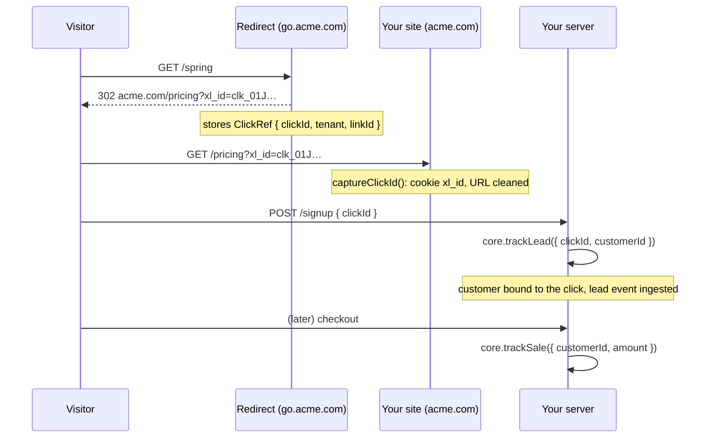

# Conversions

"Which link brought this signup, and how much revenue did it make?" Conversion attribution ties
your own leads and sales back to the click that started them, with no third-party cookies and no
SDK (ADR [0010](ADR/0010-conversion-attribution.md)).

## How it works



1. **Tag the click.** For links with `trackConversions: true` (or every link, with the redirect
   handler's `conversions: { enabled: true }`), the redirect appends `xl_id={clickId}` to the
   destination and stores a small `ClickRef` for attribution. Bot clicks never get a ref.
2. **Keep it.** On your site, `captureClickId()` moves the click id from the URL into a first-party
   cookie.
3. **Report conversions server-side.** `trackLead` binds your customer to the click; `trackSale`
   finds the customer's click and records revenue. Both events land in the analytics sink next to
   the clicks.

## 1. Turn it on

Per link:

```ts
await core.createLink({ url: "https://acme.com/pricing", slug: "spring", trackConversions: true });
```

or for every link served by a redirect handler, and optionally under another parameter name:

```ts
createRedirectHandler({ core, conversions: { enabled: true, param: "xl_id" } });
// linksRedirect({ core, conversions: { enabled: true } }) in any framework adapter
```

A link's own `trackConversions: false` opts it out even when `enabled` is set. The click id is a
time-sortable `clk_…` id (also the click event's `id`).

## 2. Capture the click id in the browser

`@xtandard/links/client` is a zero-dependency browser helper (about 1 KB):

```ts
import { captureClickId, getClickId, clearClickId } from "@xtandard/links/client";

// Once per page load on your landing pages (or in your app shell):
captureClickId();

// With your signup request:
await fetch("/api/signup", {
  method: "POST",
  headers: { "content-type": "application/json" },
  body: JSON.stringify({ email, clickId: getClickId() }),
});
```

`captureClickId(options?)` reads the parameter, validates it, stores it in a cookie and removes it
from the address bar (`history.replaceState`); with no parameter it returns the stored id.

| Option     | Default   | Notes                                                 |
| ---------- | --------- | ----------------------------------------------------- |
| `param`    | `"xl_id"` | match the redirect handler's `conversions.param`      |
| `cookie`   | `"xl_id"` | cookie name                                           |
| `days`     | `90`      | cookie lifetime                                       |
| `domain`   | host only | e.g. `".acme.com"` to share between `www.` and `app.` |
| `cleanUrl` | `true`    | strip the parameter from the visible URL              |

The cookie is first-party, `SameSite=Lax`, `Secure` on HTTPS, set by your page on your domain. It
is not `HttpOnly` (the page set it), so your server can also read the `xl_id` cookie directly from
the signup request instead of sending it in the body. `clearClickId()` forgets it.

Server-rendered or native app? Anything that reads `xl_id` from the landing URL and keeps it until
signup works; the helper is a convenience.

## 3. Track leads and sales

```ts
// When the visitor becomes a customer (signup, demo request, trial start):
const lead = await core.trackLead({
  tenant: "default", // the link's tenant; default "default"
  clickId, // from getClickId() / the xl_id cookie
  customerId: user.id, // your id for this customer
  name: "Sign up", // default "Sign up"
  customerName: user.name, // optional, stored on the customer
  customerEmail: user.email,
  metadata: { plan: "trial" },
});
// → { event: LeadEvent, customer } or null when the click is unknown

// When they pay (any time later, no click id needed):
const sale = await core.trackSale({
  customerId: user.id,
  amount: 4900, // minor units (cents)
  currency: "USD", // ISO 4217, default "USD"
  invoiceId: "inv_123", // idempotency: a repeat returns the first sale with duplicate: true
  name: "Purchase", // default "Purchase"
});
```

The rules:

- **First lead wins the binding.** The first `trackLead` for a customer binds them to that click
  (`Customer { id, tenant, clickId, linkId, firstSeenAt, … }`). Later leads and every sale for that
  customer are attributed to the same click and link (last click before the first conversion).
- **`trackSale` without a bound customer** can pass `clickId` to bind on the spot.
- **Unknown is not an error.** An unknown (or pruned) click id, or a click from another tenant,
  returns `null` (HTTP: `{ attributed: false }`): attribution is best-effort and never breaks your
  signup flow.
- **Tenants must match.** Pass the link's tenant: a click id only binds within its own tenant.
- **Idempotent sales.** With `invoiceId`, a second `trackSale` for the same invoice is ignored and
  returns the original sale with `duplicate: true`. Retry webhooks from your payment provider
  safely.
- Amounts are stored as integers in minor units; analytics sum them as-is across currencies
  (`saleAmount`), so keep one currency per tenant or break sales down yourself.

`core.getCustomer(tenant, id)` and `core.listCustomers(tenant)` read the bindings.

### Over HTTP

The panel exposes the same calls for servers that are not running the core in-process:

```sh
curl -X POST https://acme.com/links/api/track/lead \
  -u "tracker:$LINKS_TRACKER_PASSWORD" -H 'content-type: application/json' \
  -d '{ "clickId": "clk_01J…", "customerId": "user_42", "name": "Sign up" }'

curl -X POST https://acme.com/links/api/track/sale \
  -u "tracker:$LINKS_TRACKER_PASSWORD" -H 'content-type: application/json' \
  -d '{ "customerId": "user_42", "amount": 4900, "currency": "USD", "invoiceId": "inv_123" }'
```

Both require the `conversion:track` action. The simplest backend credential is a Basic-auth user
whose role grants only that action (`tracker: ["conversion:track"]` in a roles policy); see
[Auth](AUTH.md) and [Authorization](AUTHORIZATION.md). A viewer token whose `allow` includes
`conversion:track` also works, confined to its tenant. Payloads and responses:
[HTTP API](HTTP_API.md#conversions).

## Reading conversions

Leads and sales appear in every analytics query next to clicks: `totals.leads`, `totals.sales`,
`totals.saleAmount`, per time bucket and per breakdown row. Group by `link` for the leaderboard:

```ts
const { breakdown } = await core.queryAnalytics({
  tenant: "default",
  from,
  to,
  groupBy: "link",
});
// [{ key: "lnk_…", clicks: 812, leads: 37, sales: 9, saleAmount: 44100, … }, …]
```

Conversion events carry only the `link` and `domain` dimensions (country, device and the others
read `"(none)"` for them), so "sales by country" needs your own join on the click id.

`lead.created` and `sale.created` are `after` hook events ([Hooks](HOOKS.md)): forward them to your
CRM, or publish them as webhooks with `@xtandard/links/bridges/webhooks`.

## Retention

Click refs are kept for the **attribution window** (`createLinksCore({ attributionWindow })`,
default `"90d"`). `core.prune()` deletes the refs older than the window, after which a lead can no
longer bind to those clicks. Nothing calls it for you: run it on a schedule (or
`xtandard-links prune` from cron). Until a ref is pruned it stays claimable. Customers and sale idempotency records are kept until you delete
them.

## Privacy

The click id is random and carries no personal data; the cookie is first-party and set by your own
page. Nothing is shared with a third party. Whether a click id joined to your customer record is
personal data under your jurisdiction is your call, as it is for any first-party analytics.
