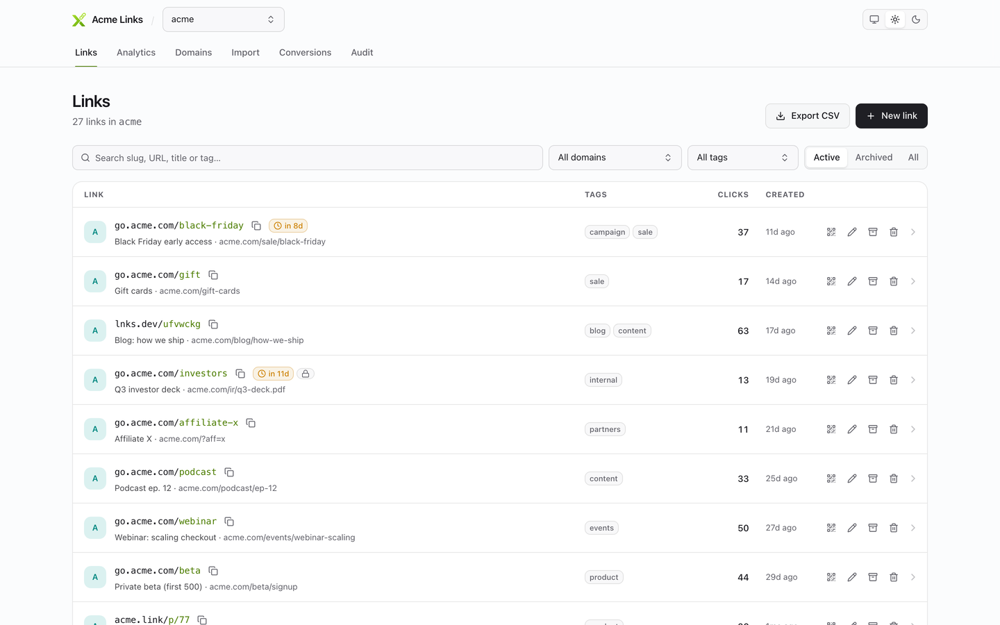
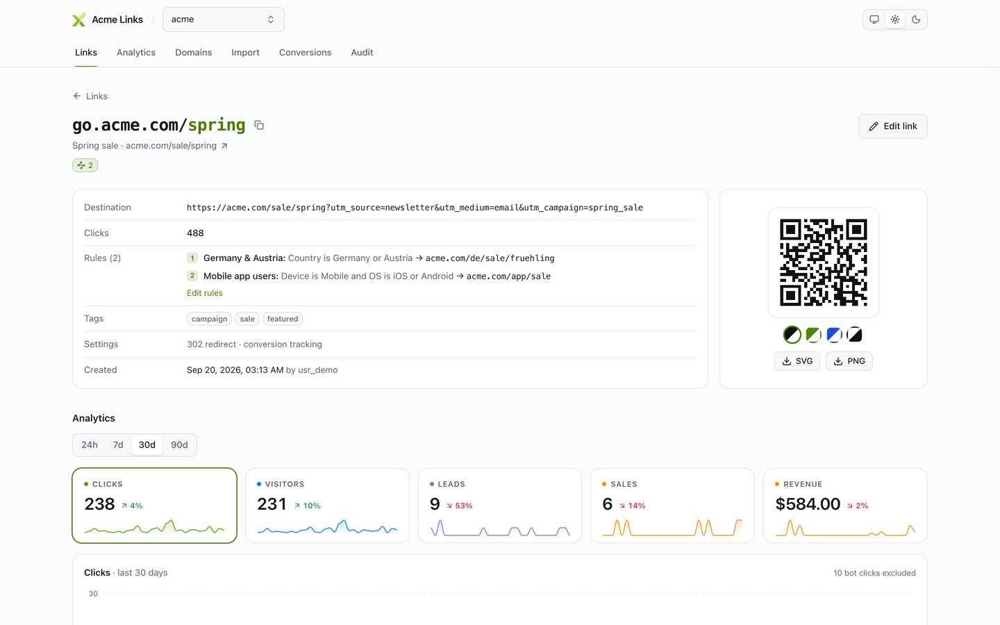
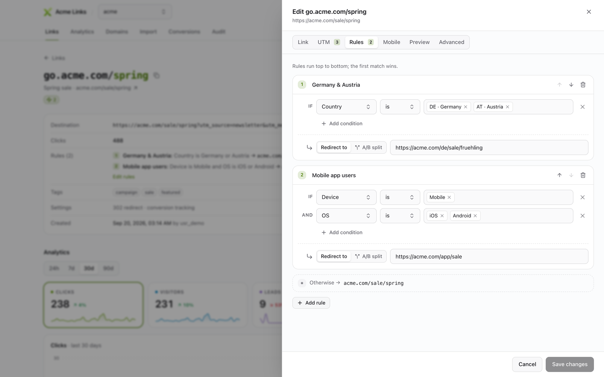
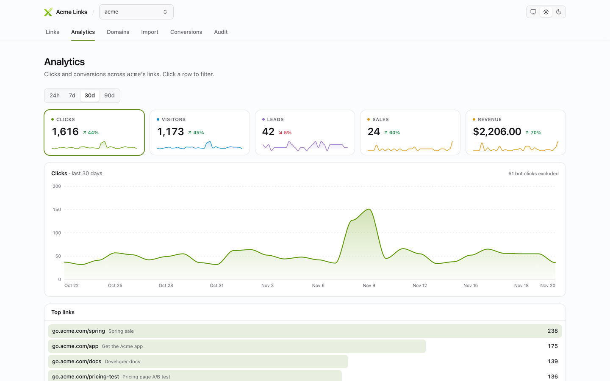
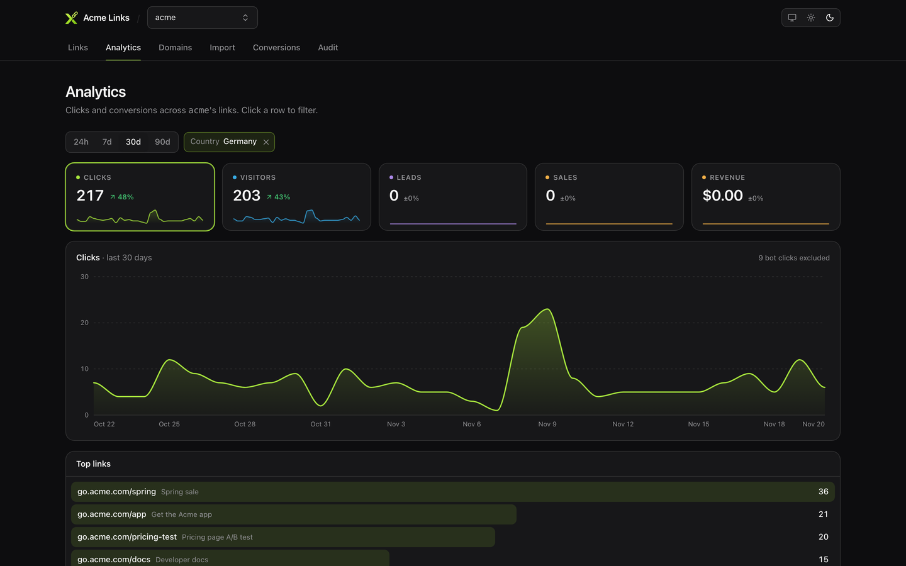
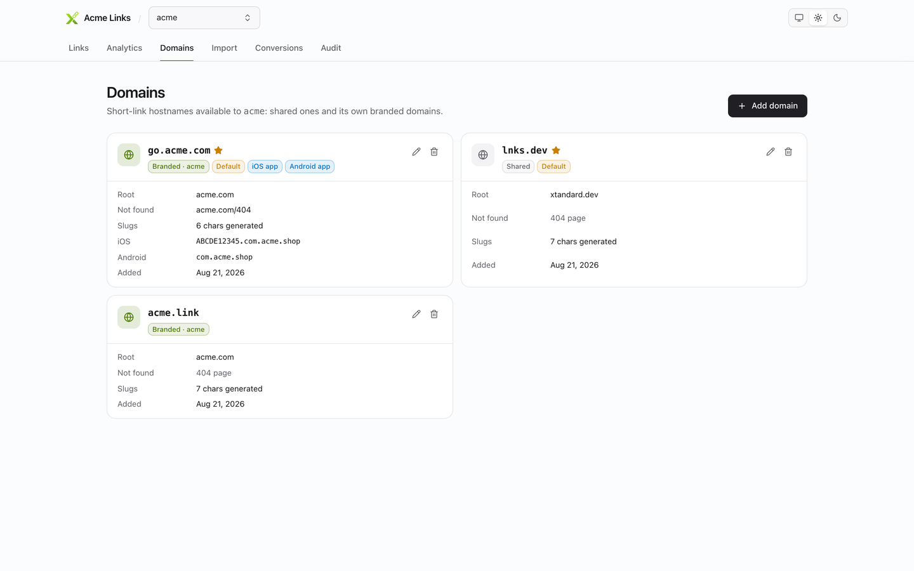
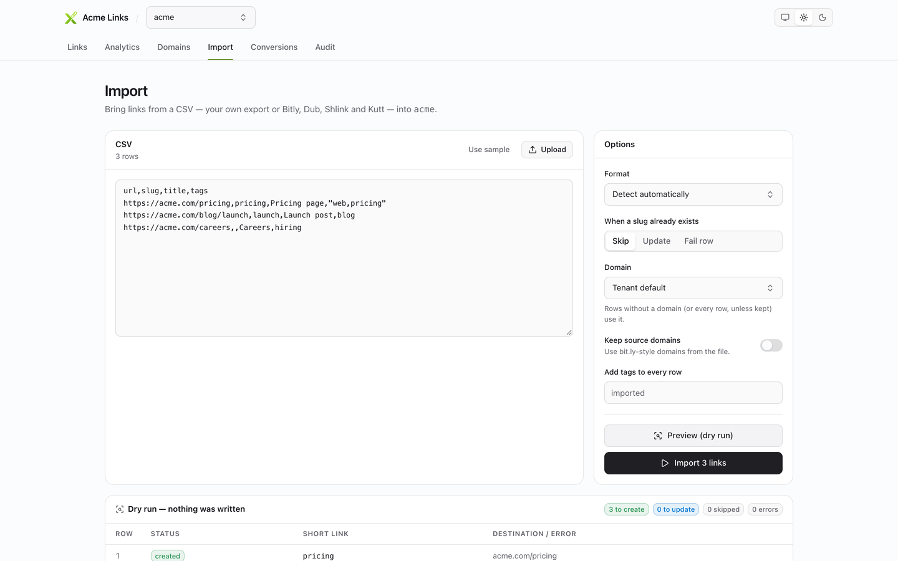
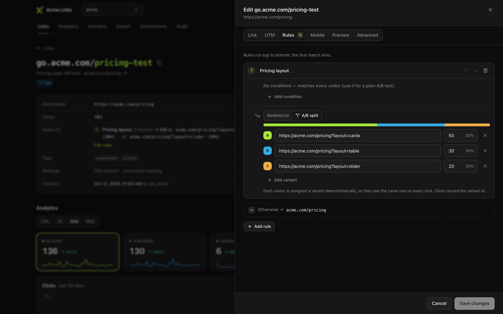
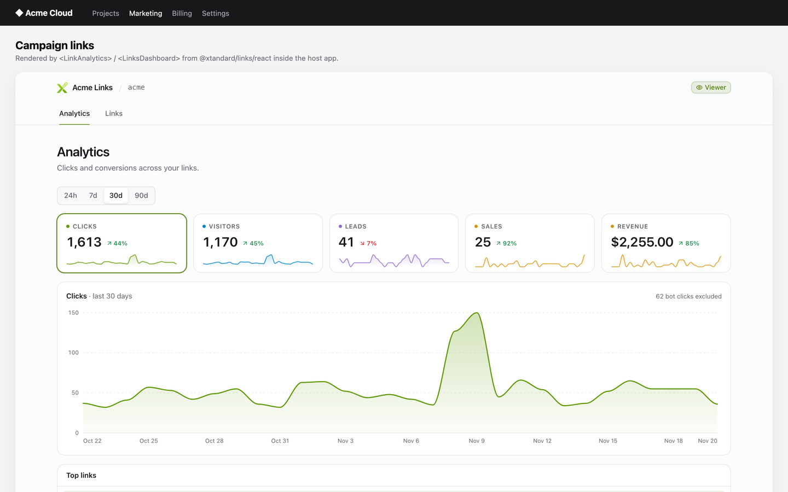

# Admin UI & React embeds

A prebuilt React SPA ships in the package (`dist/ui`) and is served by the panel handler under its
`basePath`: every framework adapter gives you the dashboard with one mount line, no build step on
your side (ADR [0003](ADR/0003-bundled-spa-ui.md)). The same bundle renders two chromes: the full
**admin dashboard**, and the reduced **analytics widget** for viewer tokens ([Widget](WIDGET.md)).
`@xtandard/links/react` exposes both as React components for hosts that render inside their own
React tree.



## The bundled dashboard

```ts
const panel = linksPanel({
  storage,
  basePath: "/links",
  title: "Acme Links", // navbar wordmark and page title
  logoUrl: "/logo.svg", // replaces the symbol + wordmark
  readonly: false, // true hides and blocks every mutation
});
```

Open `{basePath}/`. The page receives its static configuration as `window.__LINKS_CONFIG__` plus a
`<base href>`, so it works under any prefix; everything else comes from `GET {basePath}/config`
(the signed-in principal, viewer mode, the analytics sink's `capabilities`) and the JSON API
([HTTP API](HTTP_API.md)). Auth is whatever the panel's `auth` provider does: Basic auth prompts in
the browser, delegated auth uses your session cookie ([Auth](AUTH.md)). Actions the principal is
not authorized for are hidden, and so is every mutation in `readonly` mode.

The navbar holds the tenant switcher (the tenant is kept in the URL as `?tenant=`, so views are
linkable) and a system / light / dark theme switcher. The views:

| View            | What it does                                                                                                                                                                                                                                                   |
| --------------- | -------------------------------------------------------------------------------------------------------------------------------------------------------------------------------------------------------------------------------------------------------------- |
| **Links**       | Search (slug, URL, title, tags), domain and tag filters, active / archived / all; per row: copy, expiry and password badges, tags, clicks, QR, edit, archive, delete. CSV export.                                                                              |
| **Link detail** | Destination with UTM applied, clicks, a plain-language summary of the rules, tags, settings; the QR code (colour presets, SVG / PNG download); the link's analytics.                                                                                           |
| **Link editor** | A side sheet with tabs: Link (URL, domain, slug, title, tags), UTM, Rules, Mobile (iOS / Android destinations, deep link), Preview (Open Graph), Advanced (redirect status, expiry, click limit, password, conversion tracking, query pass-through, indexing). |
| **Analytics**   | Range (24h, 7d, 30d, 90d), KPI tiles that double as the chart's metric picker, the timeseries, breakdowns (top links, countries, devices, referrers, …) that filter on click.                                                                                  |
| **Domains**     | Shared and branded domains with their defaults, root / not-found redirects, generated slug length and iOS / Android app associations.                                                                                                                          |
| **Import**      | Paste or upload a CSV (native, Bitly, Dub, Shlink, Kutt; detected automatically), choose the conflict policy, domain and extra tags, preview with a dry run, then import.                                                                                      |
| **Conversions** | Customers bound to clicks by `trackLead`, with their link and first-seen time.                                                                                                                                                                                 |
| **Audit**       | The operator audit log: who created, changed or deleted what.                                                                                                                                                                                                  |

| Link detail                               | Link editor: rules                                      |
| ----------------------------------------- | ------------------------------------------------------- |
|  |           |
| **Analytics**                             | **Analytics, dark**                                     |
|      |  |
| **Domains**                               | **Import (dry run)**                                    |
|          |       |

The rules editor mirrors the engine ([Rules](RULES.md)): rules run top to bottom and the first match
wins; each rule ANDs its conditions and either redirects or splits traffic across weighted A/B
variants; "Otherwise" shows the fallback URL.



### How the analytics adapt to the sink

The analytics views read the sink's `capabilities` from `/config` ([Analytics](ANALYTICS.md#sinks)):

- **`uniques`**: the Visitors tile appears only when the sink counts unique visitors (memory,
  ClickHouse, Tinybird; not the default KV rollups or Analytics Engine).
- **`crossFilter`**: without it (KV rollups), picking a value on a second dimension replaces the
  current filter instead of combining with it, and breakdowns the sink cannot answer under the
  current filter are not requested.
- **`events`**: the recent-activity feed on the Analytics and link-detail views appears only when
  the sink keeps raw events.
- **`intervals`**: 24h is hourly, 7d hourly or daily, 30d and 90d daily, limited to what the sink
  supports.

Bot clicks are always excluded from the numbers; the chart notes how many were filtered out.

## React embeds

```tsx
import { LinksDashboard, LinkAnalytics } from "@xtandard/links/react";
import "@xtandard/links/react/styles.css";

// The full admin, inside your own React app:
<LinksDashboard apiBaseUrl="/links" theme="inherit" />;

// A customer's analytics, with a viewer token minted server-side:
<LinkAnalytics apiBaseUrl="/links" token={viewerToken} />;
```



`react` and `react-dom` (18 or 19) are optional peers needed only for this subpath; TanStack Query
and the styles are bundled. Styles are scoped under `.xtandard-links`, so they do not leak into
your page, and the embed never writes to your document (it applies its theme to its own wrapper).

### `<LinksDashboard>` props

| Prop            | Default         | Notes                                                                                                                                                                    |
| --------------- | --------------- | ------------------------------------------------------------------------------------------------------------------------------------------------------------------------ |
| `apiBaseUrl`    | `""`            | where the panel is mounted (`"/links"`, or `"https://admin.example.com/links"`)                                                                                          |
| `credentials`   | `"same-origin"` | `"include"` for a cross-origin panel with cookie auth (enable `cors` on the panel)                                                                                       |
| `fetch`         | global `fetch`  | inject a bearer token or headers, or instrument calls                                                                                                                    |
| `queryClient`   | created         | bring your own TanStack `QueryClient`                                                                                                                                    |
| `theme`         | `"auto"`        | `"auto"` (own switcher, remembered), `"inherit"` (follow the host's `dark`/`light` class or `data-theme`), `"light"`, `"dark"`                                           |
| `routing`       | `"hash"`        | `"hash"` (never touches your router), `"browser"` (clean paths; serve the panel's `index.html` as a catch-all under `routerBase`), `"memory"`, or a wouter location hook |
| `routerBase`    | —               | with `routing: "browser"`, e.g. `"/admin/links"`                                                                                                                         |
| `logoUrl`       | from `/config`  | navbar logo                                                                                                                                                              |
| `initialTenant` | first tenant    | pre-select a tenant (a `?tenant=` in the URL still wins)                                                                                                                 |
| `className`     | —               | on the root wrapper                                                                                                                                                      |

`<LinkAnalytics>` takes the same props except `initialTenant`, plus the required `token`
([Widget](WIDGET.md)). A runnable host app with both components is in
[`examples/react-embed`](../examples/react-embed).

### Cross-origin embeds

When the panel runs on another origin than the page embedding it, enable CORS on the panel and, for
cookie auth, send credentials:

```ts
linksPanel({
  storage,
  basePath: "/links",
  cors: { origin: "https://app.acme.com", credentials: true },
});
```

```tsx
<LinksDashboard apiBaseUrl="https://admin.acme.com/links" credentials="include" />
```

Viewer tokens are bearer credentials and need no cookies. `cors` also takes `methods`, `headers`
and `maxAge`; `origin` may be a list or a predicate. See [Adapters](ADAPTERS.md).

## Branding

The navbar shows the xtandard-links symbol next to `title` unless `logoUrl` is set (then the logo
replaces both); the favicon set lives in the bundle ([Brand](BRAND.md)). The UI keeps the xtandard
family's neutral palette with a lime accent, in light and dark.

## Development

```sh
bun run build:ui && bun run demo   # seeded in-memory panel + redirects on http://localhost:7790/links
bun run build:ui                   # → dist/ui (served by the panel)
bun run build:react                # → dist/react.js + scoped dist/react.css
bun run dev:ui                     # Vite dev server for the SPA source (src/ui)
bun run test:e2e                   # Playwright against the built UI and the React embed
```

`bun run demo` serves the panel and the redirect handler over realistic, deterministic seed data
(three tenants, shared and branded domains, ~40 links with rules, A/B splits and expiry, ~5 000
clicks over 90 days with leads and sales); it is also what the screenshots are taken from. Short
links resolve by hostname, so try them with a host override:
`curl -i -H "X-Forwarded-Host: go.acme.com" http://localhost:7790/spring`. UI logic lives in pure
functions under `src/ui/lib/` with unit tests; everything visual is covered by Playwright
([Testing](TESTING.md)).
