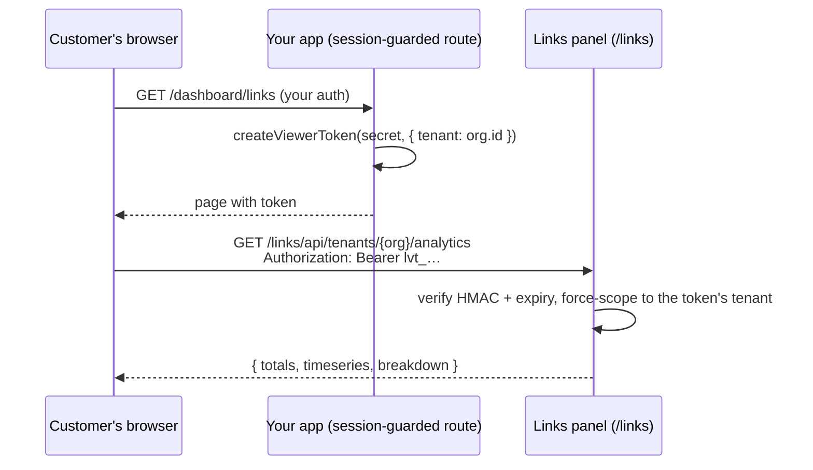
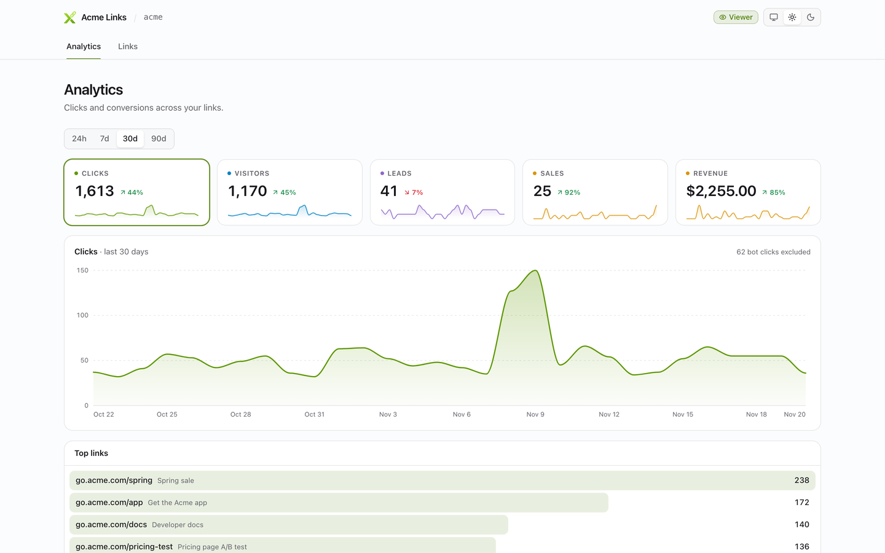

# Analytics widget

Show each of your customers the clicks on _their_ links, inside your product. Your server mints a
short-lived, tenant-scoped **viewer token**; your frontend renders `<LinkAnalytics>` (or iframes the
bundled widget) with it. No panel accounts for your customers, no sessions, no proxy routes
(ADR [0009](ADR/0009-analytics-viewer-tokens.md)).



## 1. Enable viewer tokens on the panel

```ts
const panel = linksPanel({
  storage,
  basePath: "/links",
  auth, // your admin auth, unchanged
  portal: {
    secret: process.env.LINKS_VIEWER_SECRET!, // any long random string
    allow: ["analytics:read", "link:read"], // optional; the default for tokens that name none
  },
});
```

With `portal` set, a request bearing `Authorization: Bearer lvt_…` is authenticated as a **viewer**
instead of going through your `auth` provider. The standalone server and the CLI enable it with
`VIEWER_SECRET` ([Deployment](DEPLOYMENT.md)).

## 2. Mint a token server-side

```ts
import { createViewerToken } from "@xtandard/links";

// In a route your own auth protects:
app.get("/api/links-token", async (c) => {
  const org = await requireOrg(c);
  const token = await createViewerToken(process.env.LINKS_VIEWER_SECRET!, {
    tenant: org.id, // exactly one tenant
    links: undefined, // or ["lnk_…", …] to show only some links
    allow: undefined, // default: the panel's portal.allow, then analytics:read + link:read
    expiresIn: "1h", // default "1d"
  });
  return c.json({ token });
});
```

The token is `lvt_` + base64url(`{ tenant, links?, allow?, exp }`) + `.` + an HMAC-SHA256
signature: stateless, verified with Web Crypto, nothing stored. Never mint tokens in the browser:
anyone holding the secret can mint a token for any tenant. Admins can also mint tokens over HTTP
with `POST /api/tenants/:tenant/viewer-tokens` (action `viewer-token:create`; a minter can only
delegate actions it holds itself), see [HTTP API](HTTP_API.md#viewer-tokens).

## 3. Render the widget

### React

```tsx
import { LinkAnalytics } from "@xtandard/links/react";
import "@xtandard/links/react/styles.css";

export function LinksAnalyticsPage({ token }: { token: string }) {
  return <LinkAnalytics apiBaseUrl="/links" token={token} theme="inherit" />;
}
```

`<LinkAnalytics>` sends the token as a Bearer credential on every request; `/config` then reports
`viewer: true` and the component renders the reduced widget chrome, pinned to the token's tenant
(and links, when the token lists them). It takes the same props as `<LinksDashboard>`
([UI](UI.md)) except `initialTenant`:

| Prop          | Default         | Notes                                                                            |
| ------------- | --------------- | -------------------------------------------------------------------------------- |
| `token`       | required        | the `lvt_…` viewer token                                                         |
| `apiBaseUrl`  | `""`            | where the panel is mounted (`"/links"`, or another origin)                       |
| `theme`       | `"auto"`        | `"auto"` (own switcher), `"inherit"` (follow the host page), `"light"`, `"dark"` |
| `credentials` | `"same-origin"` | fetch credentials mode                                                           |
| `fetch`       | global `fetch`  | extra headers or instrumentation                                                 |
| `routing`     | `"hash"`        | `"hash"`, `"browser"`, `"memory"` or a wouter location hook                      |
| `routerBase`  | —               | with `routing: "browser"`                                                        |
| `queryClient` | created         | bring your own TanStack `QueryClient`                                            |
| `className`   | —               | on the root wrapper                                                              |
| `logoUrl`     | from `/config`  | navbar logo                                                                      |

Styles are scoped under `.xtandard-links`, so they do not leak into your page. `react` and
`react-dom` (18 or 19) are optional peers of the package, needed only for this subpath.

Tokens expire: refetch one from your route before `exp` (or when a request answers `401
VIEWER_TOKEN`) and re-render with the new `token`.

### Without React

The bundled SPA accepts the token in the URL fragment (or the query string) and renders the same
widget chrome, so an iframe works anywhere:

```html
<iframe src="/links/#token=lvt_…" style="width: 100%; height: 640px; border: 0"></iframe>
```

The SPA removes the token from the address bar once it has read it. Prefer the fragment: it never
reaches your server or its access logs, where `?token=` does. Keep `expiresIn` short either way.

### Cross-origin

When the panel runs on another origin than your app, enable CORS on the panel (`cors` option,
[Adapters](ADAPTERS.md)) and point `apiBaseUrl` at it. Viewer tokens are bearer credentials, so no
cookies or `credentials: "include"` are needed.

## What a viewer can do

Viewer principals are **force-scoped and closed**: their tenant only, the listed link ids only
(when `links` is set), and only the actions in their `allow` list. Your `authorization` provider is
not consulted for them.

- Default actions: `analytics:read` and `link:read`.
- Grantable on top (still confined to the tenant and link set): `tenant:read`, `domain:read`,
  `link:create`, `link:update`, `link:delete`, `link:import`, `customer:read`, `audit:read`,
  `conversion:track`. Add `link:create` / `link:update` to let customers manage their own links
  through the same embed.
- Never grantable: tenant and domain management, the global audit log, minting further tokens.

Details: [Authorization](AUTHORIZATION.md).

## Revocation

Tokens are stateless: there is no list to delete from. A token stops working when it expires or
when you rotate `portal.secret` (which invalidates every outstanding token). Keep lifetimes short
(minutes to hours) and mint on demand.

## What the widget shows



The widget is the admin SPA in **viewer chrome**: the navbar shows your `title` / logo, the token's
tenant (no tenant switcher) and a "Viewer" badge, and only two tabs.

- **Analytics** (the landing view): the range picker (24h, 7d, 30d, 90d), KPI tiles for clicks,
  visitors, leads, sales and revenue with the change against the previous period, the clicks
  timeseries, and breakdowns (top links, countries, devices, referrers, …) that filter on click.
  The same capability rules as the admin apply ([UI](UI.md#how-the-analytics-adapt-to-the-sink)):
  no Visitors tile without `uniques`, one filter at a time without `crossFilter`, no
  recent-activity feed without `events`.
- **Links** (only when the token grants `link:read`, which the default does): the tenant's links,
  or only the token's `links`, with search, QR codes and each link's detail and analytics. With
  `link:create` the "New link" button appears; with `link:update` the editor opens on existing
  links. Archiving, deleting and CSV export stay admin-only in the widget chrome, whatever the
  token grants.

Numbers always exclude bot clicks. A runnable host app with the widget is
[`examples/react-embed`](../examples/react-embed); the screenshot of it inside a host page is in
[UI](UI.md#react-embeds).
