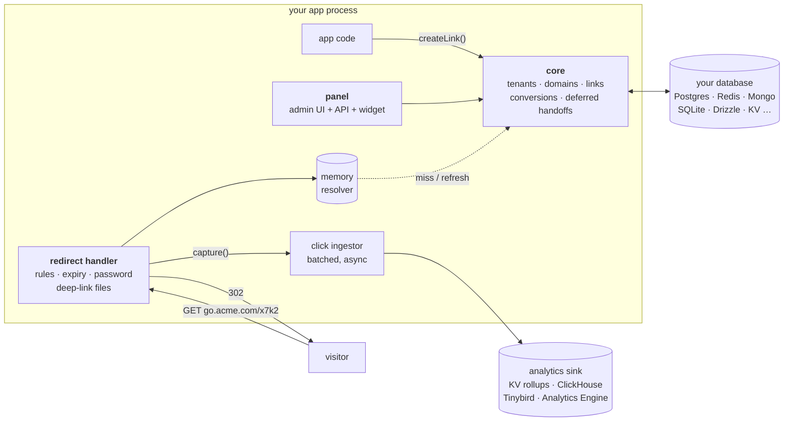

{/* The home page: written for the site; its content follows the root README.
scripts/sync.ts replaces the BASE, REPO and NPM tokens. */}

import { Card, CardGrid, LinkCard, Tabs, TabItem } from "@astrojs/starlight/components";

```sh
npm install @xtandard/links
```

A Dub / Bitly alternative you embed instead of rent. A redirect never waits on your database or
your analytics: links resolve from memory, clicks are captured in the background, and your
customers see their own numbers through an embeddable widget.

## A quick taste

<Tabs syncKey="home-taste">
<TabItem label="Mount">

```ts
import { Hono } from "hono";
import { linksPanel, linksRedirect } from "@xtandard/links/hono";
import { createSqliteStorage } from "@xtandard/links/storage/sqlite";

const panel = linksPanel({
  storage: createSqliteStorage({ path: "links.db" }),
  basePath: "/links",
  defaultDomain: "localhost",
});

const app = new Hono();
app.route("/links", panel); // admin UI + JSON API
app.use(linksRedirect({ core: panel.core })); // GET /{slug} → redirect, else next()
```

Adapters for Hono, Elysia (1 and 2), Express, Bun and Next.js; storage on Postgres, Redis, MongoDB,
SQLite, libSQL, Drizzle, unstorage, Cloudflare KV, files or memory.
[Quickstart →](@BASE@/guides/quickstart/)

</TabItem>
<TabItem label="Create">

```ts
const { core } = panel;

await core.createDomain({ hostname: "go.acme.com", isDefault: true });

const link = await core.createLink({
  url: "https://acme.com/pricing",
  slug: "pricing", // omit for a generated 7-character slug
  tags: ["launch"],
  utm: { source: "newsletter", campaign: "spring" },
  expiresAt: "2027-01-01T00:00:00Z",
});
// https://go.acme.com/pricing → 302 https://acme.com/pricing?utm_source=newsletter&utm_campaign=spring
```

Tenants, branded domains per customer, expiry and click budgets, passwords, link previews, QR codes
and CSV import from Bitly, Dub, Shlink and Kutt. [Links & domains →](@BASE@/concepts/links/)

</TabItem>
<TabItem label="Target">

```ts
await core.createLink({
  slug: "app",
  url: "https://acme.com/download",
  ios: "https://apps.apple.com/app/id123456789",
  android: "https://play.google.com/store/apps/details?id=com.acme",
  rules: [
    {
      when: [{ field: "country", op: "in", values: ["DE", "AT", "CH"] }],
      url: "https://acme.de/download",
    },
    {
      when: [], // everyone else: a 50/50 split, sticky per visitor
      variants: [
        { id: "a", url: "https://acme.com/download?v=a", weight: 50 },
        { id: "b", url: "https://acme.com/download?v=b", weight: 50 },
      ],
    },
  ],
});
```

Ordered rules, first match wins, deterministic A/B variants.
[Targeting rules →](@BASE@/concepts/rules/)

</TabItem>
<TabItem label="Measure">

```ts
const stats = await core.queryAnalytics({
  tenant: "default",
  from: "2026-11-01T00:00:00Z",
  to: "2026-12-01T00:00:00Z",
  interval: "day",
  groupBy: "country",
});
// { totals: { clicks, botClicks, leads, sales, saleAmount }, timeseries: [...], breakdown: [...] }
```

Bots and link previews flagged, device / OS / browser parsed, geo from edge headers, IPs dropped by
default. Rollups in your own database on day one; ClickHouse, Tinybird or Workers Analytics Engine
when you outgrow it. [Click analytics →](@BASE@/analytics/)

</TabItem>
<TabItem label="Attribute">

```ts
// On your landing page (browser):
import { captureClickId, getClickId } from "@xtandard/links/client";
captureClickId(); // stores ?xl_id=clk_… in a first-party cookie

// On your server, when the visitor signs up and pays:
await core.trackLead({ clickId, customerId: user.id, name: "Sign up" });
await core.trackSale({ customerId: user.id, amount: 4900, currency: "USD", invoiceId: "inv_1" });
```

"Which link brought this customer?" Leads and sales land next to clicks in every analytics query.
[Conversions →](@BASE@/analytics/conversions/)

</TabItem>
<TabItem label="Embed">

```tsx
// Your server, after your own auth:
import { createViewerToken } from "@xtandard/links";
const token = await createViewerToken(process.env.LINKS_VIEWER_SECRET!, { tenant: org.id });

// Your React frontend:
import { LinkAnalytics } from "@xtandard/links/react";
import "@xtandard/links/react/styles.css";

<LinkAnalytics apiBaseUrl="/links" token={token} />;
```

Each of your customers sees the clicks on _their_ links inside your product, scoped by a signed,
stateless token. [Analytics widget →](@BASE@/ui/widget/)

</TabItem>
</Tabs>

## How it fits together



Two planes: the **control plane** (core, admin API, UI, widget) is rare and human-driven; the
**redirect plane** is hot, anonymous and full of bots. The redirect answers from an LRU with
stale-while-revalidate and last-known-good, never waits on the analytics sink, and never throws
into your app. [Architecture →](@BASE@/concepts/architecture/)

## Why @xtandard/links

<CardGrid>
  <Card title="A library, not a service" icon="puzzle">
    `bun add` and the database you already have. Every maintained permissive shortener is a
    standalone app; the TypeScript ones with real analytics are AGPL. This one mounts in your app.
  </Card>
  <Card title="Redirects that always answer" icon="rocket">
    Memory-first resolution, a negative cache for slug scanners, last-known-good when storage
    hiccups, and edge `waitUntil` support. Runs on Workers and Vercel with zero optional deps.
  </Card>
  <Card title="Analytics you can grow into" icon="bars">
    Same-database rollups on day one. Swap the sink for ClickHouse, Tinybird or Workers Analytics
    Engine and keep everything else; every sink passes one conformance suite.
  </Card>
  <Card title="Multi-tenant by design" icon="open-book">
    Every link belongs to a tenant, tenants own branded domains, and a scoped viewer token embeds
    per-customer analytics in your product.
  </Card>
</CardGrid>

## Guides

<CardGrid>
  <LinkCard
    title="Getting started"
    href="@BASE@/getting-started/"
    description="Install, mount the panel and the redirect handler, register a domain, create and click a link."
  />
  <LinkCard
    title="Links & domains"
    href="@BASE@/concepts/links/"
    description="Tenants, domains, slugs, expiry, passwords, previews, UTM, QR codes, import and export."
  />
  <LinkCard
    title="Click analytics"
    href="@BASE@/analytics/"
    description="Enrichment, privacy modes, the query model, and the KV, ClickHouse, Tinybird and Analytics Engine sinks."
  />
  <LinkCard
    title="Deep links"
    href="@BASE@/analytics/deep-links/"
    description="Universal links and app links on your own domain, store routing and deferred deep linking."
  />
  <LinkCard
    title="Storage"
    href="@BASE@/storage/"
    description="The four-method KV contract, every driver, compare-and-swap and change notifications."
  />
  <LinkCard
    title="Deployment"
    href="@BASE@/operations/deployment/"
    description="Embedded, split redirect/edge, Docker, Cloudflare Workers and Vercel/Next.js."
  />
</CardGrid>

## The xtandard ecosystem

`@xtandard/links` has siblings: open-source, MIT-licensed projects that share the xtandard name.
Each one stands on its own.

<CardGrid>
  <LinkCard
    title="@xtandard/flags"
    href="https://me.xantiagoma.com/xtandard-flags/"
    description="Self-hosted, embeddable, OpenFeature-compatible feature flags with pluggable storage. Same architecture and design system."
  />
  <LinkCard
    title="@xtandard/webhooks"
    href="https://me.xantiagoma.com/xtandard-webhooks/"
    description="Self-hosted, embeddable, Standard Webhooks-compliant outbound webhooks: a Svix alternative as a library."
  />
  <LinkCard
    title="@xtandard/audit"
    href="https://me.xantiagoma.com/xtandard-audit/"
    description="Self-hosted, tamper-evident audit logs for B2B SaaS: a WorkOS Audit Logs alternative as a library."
  />
  <LinkCard
    title="@xtandard/entitlements"
    href="https://me.xantiagoma.com/xtandard-entitlements/"
    description="Plans, entitlements and usage metering: typed catalog, atomic metering, any billing provider."
  />
  <LinkCard
    title="@xtandard/lib"
    href="https://me.xantiagoma.com/xtandard/"
    description="Lightweight, type-safe TypeScript utilities with a zero-dependency core."
  />
  <LinkCard
    title="xtandard-image"
    href="https://me.xantiagoma.com/xtandard-image/"
    description="Self-hosted image and video processing in Go and libvips, with imgproxy-compatible URLs."
  />
</CardGrid>

All of them, with npm and GitHub links: [the xtandard ecosystem](@BASE@/project/ecosystem/).
